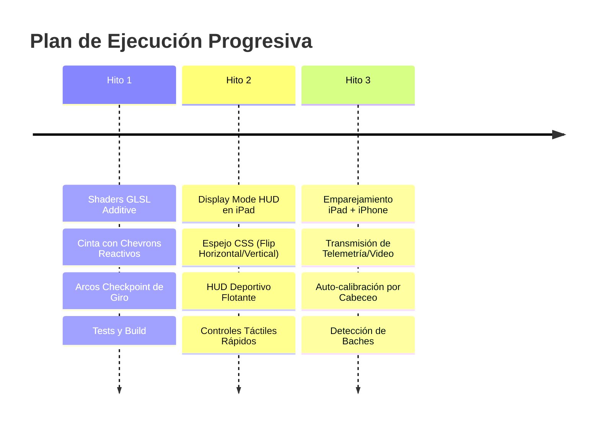

# Plan Maestro de Implementación: HUD Parabrisas y Señalización Diegética 3D (Setup iPad + iPhone)

> **Estado (24 oct):** la óptica del Hito 2 ya está hecha con cálculo exacto en vez del espejo CSS fijo: reflexión en el parabrisas, perspectiva desde el ojo y corrección del texto (ver `SPEC.md` §5.4, `src/render/optics.ts`). El espejo ⇄ ⇅ sigue como modo simple. El enlace del Hito 3 ya funciona con el iPhone como sensor (GPS + inclinación, sin video) sobre WebRTC/PeerJS; está pendiente decidir si se pasa a Supabase Realtime (pasa por la nube, más latencia) o se queda en WebRTC (directo por el hotspot).

## 1. Goal Description

Implementar en **Vía AR (`flechitas`)** un sistema de navegación por proyección en parabrisas (**Windshield HUD**) con señalización diegética 3D inspirada en videojuegos (*Forza*, *Cyberpunk 2077*, *GTA V*), operando sobre una **arquitectura distribuida de dos dispositivos en el vehículo**:
- **Pantalla / Proyector HUD: iPad.** Colocado horizontalmente sobre el tablero del carro, mirando hacia arriba. Aprovecha el gran tamaño del panel Retina y su alta luminancia para proyectar un holograma amplio, nítido y de gran cobertura sobre el parabrisas con fondo negro absoluto (`#000000`) e inversión en espejo (`transform: scale(-1, 1)`).
- **Cámara POV & Sensor Hub: iPhone.** Montado con soporte fijo en el parabrisas, apuntando a la carretera. Su cámara graba el POV exterior y sus sensores inerciales (acelerómetro y giroscopio) detectan cabeceo (*pitch*), horizonte y baches en la vía (*huecos y policías acostados*).
- **Enlace en el Vehículo:** El iPad se conecta al **Punto de Acceso Wi-Fi (Hotspot)** del iPhone. La sincronización se realiza mediante **canales efímeros de Supabase Realtime Broadcast** (usando las credenciales existentes en el proyecto), logrando latencias de telemetría inferiores a 30 ms sin consumo innecesario de datos móviles.

```mermaid
flowchart TD
    subgraph iPhoneNode ["iPhone (Montado en Parabrisas - Sensor & Cámara POV)"]
        CAM["Cámara Trasera (POV Carretera)"]
        IMU["Giroscopio & Acelerómetro (Pitch / Bumps)"]
        GPS_PHONE["GPS de Alta Precisión"]
        SYNC_TX["Supabase Realtime Broadcast (Transmisor)"]
        
        CAM --> SYNC_TX
        IMU --> SYNC_TX
        GPS_PHONE --> SYNC_TX
    end

    subgraph iPadNode ["iPad (Sobre el Tablero - Motor Gráfico Three.js)"]
        SYNC_RX["Supabase Realtime Broadcast (Receptor)"]
        ENGINE["Three.js ArScene + Shaders GLSL Additive"]
        HUD_UI["HUD Deportivo (Velocidad, Próximo Giro, Alertas)"]
        CANVAS["Canvas Espejado (transform: scale -1, 1)"]
        
        SYNC_RX --> ENGINE
        ENGINE --> CANVAS
        HUD_UI --> CANVAS
    end

    subgraph OpticaCarro ["Óptica en el Parabrisas"]
        GLASS["Parabrisas del Carro"]
        EYE["Ojo del Conductor (Eyebox)"]
        ROAD["Carretera Real"]
        
        CANVAS -->|Proyección Luminosa en Fondo Negro| GLASS
        GLASS -->|Reflejo Corregido Ópticamente| EYE
        ROAD -.->|Visión Directa a través del Vidrio| EYE
    end

    SYNC_TX ==>|Hotspot Wi-Fi Local + Supabase Realtime (< 30ms)| SYNC_RX
```

---

## 2. Decisiones de Diseño Consolidadas (/grill-me)

| Dimensión | Decisión Acordada | Justificación Técnica |
| :--- | :--- | :--- |
| **Hardware** | **iPad (Tablero / HUD) + iPhone (Parabrisas / Cámara)** | El iPad proporciona el área de pantalla y brillo necesarios para un HUD legible en el vidrio; el iPhone tiene la cámara y sensores en la posición ideal de la vía. |
| **Configuración Óptica** | **HUD Reflectivo Puro en Parabrisas** | La pantalla del iPad proyecta únicamente gráficos vectoriales/3D de alto brillo sobre fondo `#000000` (con espejo CSS). El video de la cámara no se refleja en el vidrio para no crear parches opacos que tapen el tráfico. |
| **Sincronización** | **Hotspot Wi-Fi del iPhone + Supabase Realtime Broadcast** | Conexión local automática en el carro. El canal `hud-telemetry` de Supabase sincroniza cabeceo, posición y baches en < 30 ms sin requerir infraestructura externa. |
| **Rol de la Cámara POV** | **Visión Computacional & Sensor Fusion** | La cámara del iPhone detecta el horizonte y cabeceo del carro ante frenadas y pendientes, auto-calibrando la cinta 3D sobre el asfalto y reportando huecos. |
| **Densidad de UI** | **Minimalista Deportivo (Alto Contraste)** | Cinta con chevrons fluidos + arcos checkpoint 3D en maniobras + velocímetro y distancia al próximo giro en esquina. Cero fondos opacos ni tarjetas grises. |
| **Controles de Reflejo** | **Botones Táctiles Flotantes de un Toque** | Botón de espejo (`Mirror X / Flip Y`) en borde de pantalla, botón gigante de reporte rápido de huecos y selector Día/Noche con accesibilidad rápida. |
| **Estrategia de Ejecución** | **3 Hitos Progresivos** | Hito 1 (Shaders diegéticos) $\rightarrow$ Hito 2 (Modo HUD Parabrisas en iPad) $\rightarrow$ Hito 3 (Enlace y streaming con iPhone). |

---

## 3. Hoja de Ruta de Implementación por Hitos



---

## 4. Cambios Propuestos por Componente

### Componente 1: Shaders Diegéticos de Alto Rendimiento (`src/render/`)

#### [NEW] `src/render/shaders.ts`
Implementación de los programas de vertex y fragment shader GLSL con `THREE.AdditiveBlending` para simular resplandor neón a 60 FPS sin post-procesamiento bloom:
- **Cinta de Asfalto Reactiva:** Modulación dinámica de color según curvatura ($\kappa$) y peligro (Cian `#00e5ff` $\rightarrow$ Ámbar `#ffb300` $\rightarrow$ Carmesí `#ff1744`) con chevrons direccionales animados hacia adelante con la velocidad.
- **Arcos Checkpoint 3D:** Puertas holográficas volumétricas en puntos de giro que se desvanecen con efecto alfa al atravesarlas.
- **Faro Vertical de Destino (Beacon):** Columna de luz de 40 metros en el punto de llegada con anillos concéntricos en el suelo.

#### [MODIFY] `src/render/ar.ts`
- Modificar `updateRibbon()` para suministrar los atributos de textura UV continua y el grado de peligro `aDanger`.
- Sustituir la flecha 2D flotante por el **Arco Checkpoint Holográfico** en el punto de maniobra (`f.next.location`).
- Añadir el soporte para alternar entre el estilo de renderizado `camera` y `hud` (trazos más gruesos y chevrons sólidos en HUD).

---

### Componente 2: Modo HUD Parabrisas para iPad (`src/render/`, `src/core/`, `src/main.ts`)

#### [MODIFY] `src/core/state.ts`
- Agregar tipos para el modo de pantalla:
  ```typescript
  export type DisplayMode = 'camera' | 'hud';
  export type DeviceRole = 'standalone' | 'hud_display' | 'camera_sensor';
  export interface HudMirror {
    mirrorX: boolean; // Flip horizontal para reflejo en vidrio
    flipY: boolean;   // Flip vertical
    nightMode: boolean;
  }
  ```

#### [MODIFY] `src/render/hud.ts`
- Implementar el layout HUD deportivo: tipografía extra-grande (≥ 48px) para el velocímetro, icono limpio de maniobra y distancia, sobre fondo negro absoluto `#000000`.

#### [MODIFY] `src/render/calib.ts` y `src/render/calibDock.ts`
- Soporte para perfiles independientes (`ar-nav.calib.hud` optimizado para el ángulo de reflexión del parabrisas y la distancia visual del iPad).

#### [MODIFY] `src/main.ts` y `index.html`
- Añadir botones flotantes táctiles de acceso rápido:
  - Botón de inversión en espejo `[ ⇄ ]` (aplica `transform: scale(-1, 1)` sobre el canvas y el HUD).
  - Botón gigante de reporte rápido de huecos `[ ⚠ ]`.
  - Selector de paleta Día / Noche.

---

### Componente 3: Emparejamiento y Streaming iPhone $\leftrightarrow$ iPad (`src/drive/`, `src/sync/`)

#### [NEW] `src/sync/nodePairing.ts`
- Emparejamiento instantáneo mediante Supabase Broadcast (utilizando el proyecto ya configurado `fnvysedqoujmslfgwrok.supabase.co`):
  1. El iPad muestra un código de sesión o QR (o canal `hud-car-session`).
  2. El iPhone se conecta como `camera_sensor` y transmite:
     - Tasa de cabeceo (*pitch*) y balanceo (*roll*) a 20 Hz.
     - Eventos de impacto de baches (`hazards/bump.ts`).
     - Coordenadas GPS de precisión.
     - Stream de video opcional vía WebRTC P2P en red local para auto-alineación visual.
  3. El iPad (nodo `hud_display`) recibe la telemetría y ajusta la perspectiva de Three.js en tiempo real.

---

## 5. Plan de Verificación y Criterios de Calidad

### Pruebas Automatizadas
1. **Regresiones en Suite Existente:**
   ```bash
   npm test
   ```
   *Criterio:* Los 51 tests actuales deben continuar en 100% verde.
2. **Compilación Estricta de Producción:**
   ```bash
   npm run build
   ```
   *Criterio:* Cero errores de tipos TypeScript (`tsc --noEmit`) y empaquetado exitoso en Vite.

### Verificación Manual Paso a Paso
1. **Hito 1 (Shaders Diegéticos):**
   - Probar en modo `Simulación` en navegador que la cinta muestre chevrons fluidos, responda a la velocidad y cambie de color en curvas pronunciadas.
   - Verificar la aparición y desvanecimiento de los arcos checkpoint en los giros.
2. **Hito 2 (Modo HUD en iPad):**
   - Abrir la app en Safari en el iPad. Activar `HUD Parabrisas`.
   - Comprobar que el fondo sea negro puro (`#000000`) y probar el botón de espejo `[ ⇄ ]`.
   - Colocar el iPad en el tablero frente al parabrisas de noche o en garaje y verificar la legibilidad y nitidez del reflejo en el cristal.
3. **Hito 3 (Enlace iPhone + iPad):**
   - Conectar el iPad a la red Wi-Fi compartida por el iPhone (Hotspot).
   - Iniciar el iPhone en modo `Sensor/Cámara` y el iPad en modo `HUD Display`.
   - Mover el iPhone y verificar que el cabeceo en el iPad se ajuste inmediatamente con latencia imperceptible (< 30 ms).

---

## 6. Regla de Oro de CI/CD para Despliegues

> [!CRITICAL]
> **Despliegues Automáticos en Vercel:**
> - El desarrollo activo de estos 3 hitos se realizará y validará en local.
> - Antes de integrar cualquier cambio o hacer push a `main`, es mandatorio ejecutar:
>   `npm test && npm run build`
> - Cada push a `main` actualiza inmediatamente `https://ar-nav-sage.vercel.app` para que el equipo pueda probar las novedades directamente en la calle.
