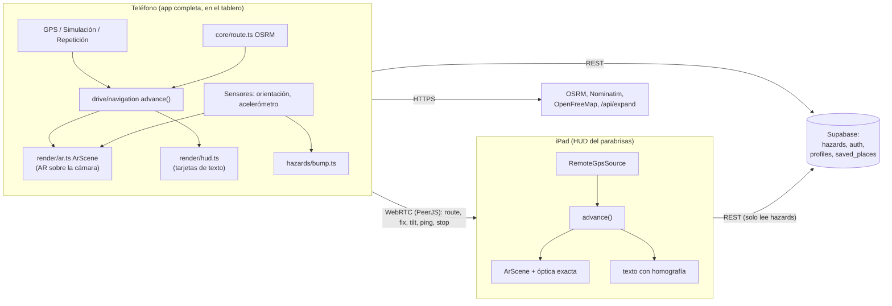
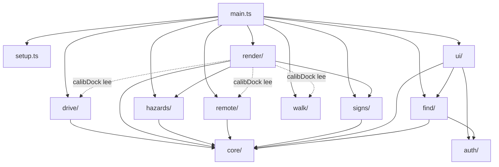
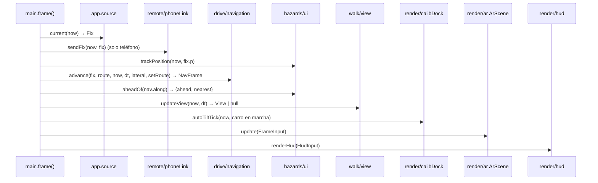
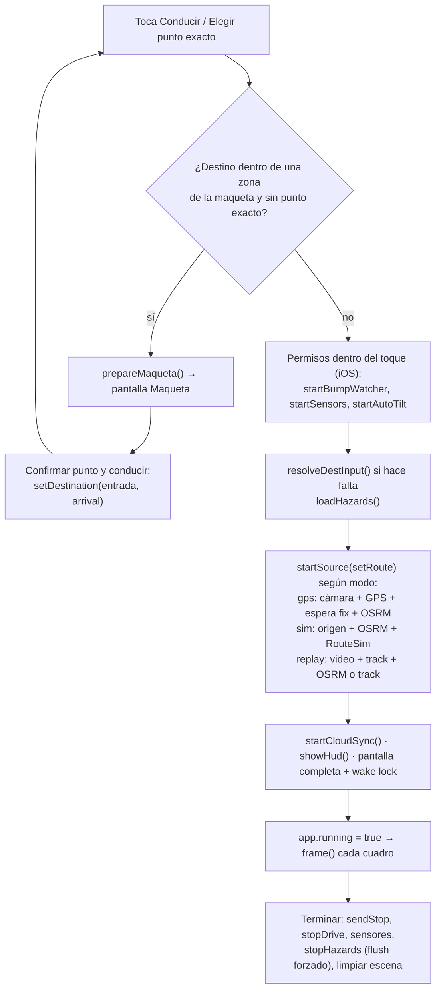
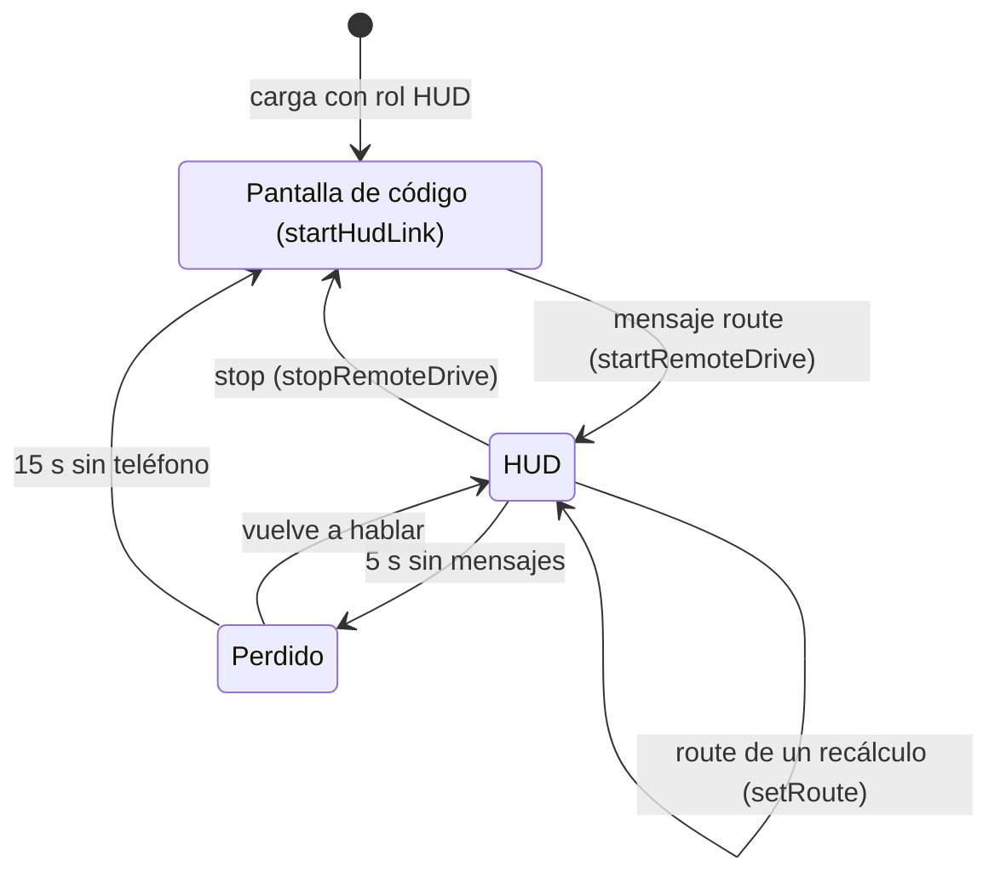

# Arquitectura y flujo de datos

[← Índice](README.md)

MapZ (nombre de la interfaz; el manifest de la PWA y algunos textos todavía dicen *Vía AR*) es una sola
aplicación web: Vite + TypeScript + Three.js, sin framework de UI, sin servidor propio salvo una función
de Vercel (`api/expand.ts`) y una base Supabase opcional. Todo corre en el navegador.

## 1. Dos roles, un mismo código

La misma página se comporta distinto según el rol del equipo, decidido una vez al cargar
([src/main.ts](../src/main.ts), `isHudRole()`):

| Rol | Cómo se activa | Qué hace |
|---|---|---|
| **Teléfono** (por defecto) | — | Toda la app: Mapa/Destino, Maqueta, Encontrar, Ajustes. Al conducir, va fijo al tablero y muestra la **AR sobre la cámara**. Tiene el GPS, los sensores, la ruta y la detección de huecos. |
| **iPad = HUD del parabrisas** | `?role=hud` en la URL, o *Ajustes → Dispositivos → Avanzado → Usar esta pantalla como HUD del parabrisas* (se guarda en `localStorage['ar-nav.role'] = 'hud'`) | Pantalla negra con un código de 6 dígitos. Cuando el teléfono empieza un viaje, dibuja la guía **reflejada en el parabrisas** con la óptica exacta. Navega solo a partir de la ruta y los fixes GPS que le manda el teléfono. *Usar como teléfono* lo devuelve al rol normal. |

Hay un tercer caso menor: un solo equipo con *Pantalla de este equipo → HUD aquí* (`app.display = 'hud'`).
Dibuja el HUD con su propio GPS, sin cámara y sin actitud del carro. Sirve para probar el HUD sin iPad.

## 2. Carpetas y dependencias

El código está partido por áreas para que el equipo trabaje en paralelo. `core/` es compartido; los demás
módulos se hablan por funciones pequeñas. Detalle archivo por archivo en [modulos.md](modulos.md).

| Carpeta | Responsabilidad |
|---|---|
| `src/main.ts` | Raíz de composición: decide el rol, conecta módulos, arranca y para viajes, corre el bucle por cuadro. |
| `src/setup.ts` | Opciones del viaje en el teléfono: modo, origen, destino (escrito, pegado o compartido desde Maps/Waze). |
| `src/core/` | Compartido: geometría (`geo.ts`), rutas OSRM (`route.ts`), enlaces y geocodificación (`links.ts`), teselas de la maqueta (`maqueta.ts`), tipos (`types.ts`), estado global mínimo (`state.ts`), helpers de DOM (`ui.ts`). |
| `src/drive/` | Navegación sin sensores de orientación: fuentes de posición, seguimiento de la ruta y recálculo, grabador, arranque por modo. |
| `src/walk/` | Sensores de orientación del teléfono (brújula, inclinación, giro) para la vista en la mano (*Caminar*). |
| `src/render/` | Escena 3D (`ar.ts`), óptica del parabrisas (`optics.ts`, `hudSetup.ts`), calibración (`calib.ts`, `autocalib.ts`, `calibDock.ts`), señales 3D, calle 3D de la maqueta, HUD de texto. |
| `src/remote/` | Enlace teléfono ↔ iPad: contrato (`protocol.ts`), lado teléfono (`phoneLink.ts`), lado iPad (`hudLink.ts`), orientación física (`orient.ts`). |
| `src/hazards/` | Huecos y policías acostados: almacén, agrupación, detección por acelerómetro, cola de subida a Supabase, UI. |
| `src/signs/` | Señales de tránsito de la maqueta que aplican a la ruta. |
| `src/find/` | *Encontrar* (compartir ubicación en vivo) y los lugares guardados (`pins.ts`, `pinsSync.ts`). |
| `src/auth/` | Cuentas por la API REST de Supabase Auth. |
| `src/ui/` | Pantallas del teléfono: navegación inferior (`shell.ts`), mapa (`destino.ts`), maqueta (`maqueta.ts`), lugares (`lugares.ts`), sincronización de lugares (`syncPins.ts`). |
| `api/expand.ts` | Función de Vercel que expande enlaces cortos de Google Maps. |
| `scripts/maqueta/` | Script que genera las teselas de `public/maqueta/`. |

Dependencias principales entre módulos (flechas = "importa a"):

Notas: `render/calibDock.ts` depende de `drive/sources.ts` (para la sincronía de la repetición),
`remote/hudLink.ts` (inclinación del teléfono) y `walk/` (sensores); está anotado como deuda en
[TODO.md](../TODO.md). `core/state.ts` importa el tipo `Arrival` de `remote/protocol.ts`.

## 3. Estado compartido

Cada módulo guarda su propio estado privado. Lo único global es `app` en
[src/core/state.ts](../src/core/state.ts):

| Campo | Tipo | Quién escribe | Para qué |
|---|---|---|---|
| `mode` | `'gps' \| 'sim' \| 'replay'` | `setup.ts` (radio *Modo*), `main.ts` en el iPad | De dónde sale la posición. |
| `display` | `'camera' \| 'hud'` | `setup.ts` (*Pantalla de este equipo*), `main.ts` en el iPad | Cómo se dibuja: AR sobre cámara o HUD del parabrisas. |
| `dest` | `{point, label} \| null` | `setup.ts`, `ui/destino.ts`, `ui/lugares.ts` | Destino elegido. |
| `from` | `LatLon \| null` | `ui/destino.ts` | Origen de una simulación (escrito o puesto en el mapa); `null` = GPS. |
| `route` | `Route \| null` | `main.ts` `setRoute()` | Ruta activa. |
| `arrival` | `Arrival \| null` | `setup.ts` (desde la Maqueta), `main.ts` en el iPad | Punto exacto de llegada (entrada de un edificio). |
| `source` | `Source \| null` | `drive/start.ts`, `main.ts` en el iPad | Fuente de posición activa. |
| `stream` | `MediaStream \| null` | `drive/start.ts`, `find/ui.ts` | Video de la cámara. |
| `running` | `boolean` | `main.ts` | Hay un viaje en curso (el bucle corre). |
| `yaw` | grados | `drive/navigation.ts` | Rumbo suavizado del carro. |

## 4. El bucle por cuadro

`frame()` en [src/main.ts](../src/main.ts) corre con `requestAnimationFrame` mientras `app.running`.
`dt` se limita a 0,2 s. En cada cuadro:

- **Modo degradado (H9).** En modo `gps`, si el último fix tiene más de 3 s o precisión peor que 30 m,
  `degraded = true` y la cinta no se dibuja; la flecha de giro y la tarjeta de maniobra siguen.
- **Actitud del carro (solo HUD).** `carAttitude()` resta a la inclinación del teléfono su inclinación
  en reposo (la calibrada) y la filtra a ~3 Hz. Ver [optica-hud.md](optica-hud.md#7-actitud-del-carro).
- **Escenario 3D.** En Simulación se pasa `scenery = maqueta.tiles` y la calle 3D sustituye a la cámara
  donde haya teselas. Ver [render-ar.md](render-ar.md#9-la-calle-3d-de-la-maqueta-en-simulación).

`FrameInput` y `HudInput` son los dos contratos del renderizador; están descritos en
[render-ar.md](render-ar.md#2-el-contrato-frameinput).

## 5. Ciclo de vida de un viaje (teléfono)

`setRoute(r)` es el único lugar donde cambia la ruta (inicio y cada recálculo):

1. `app.route = r` y `resetProgress()`.
2. Si el iPad está enlazado, `sendRoute(r, app.arrival)`.
3. Borra la maqueta anterior y las señales; `setOsmHazards([])` reindexa los peligros sobre la nueva ruta.
4. Carga la maqueta de la ruta en segundo plano (`loadRouteMaqueta`). Al llegar, si la ruta no cambió:
   perfil de elevación, límites de velocidad, señales y policías acostados de OSM.

## 6. Ciclo de vida en el iPad

`startRemoteDrive()` pone `mode = 'gps'`, `display = 'hud'`, usa `remoteGps` como fuente, carga los
peligros compartidos, llama `setRoute()` y `startAutoTilt()` (que en el iPad toma la inclinación del
teléfono). Detalle del protocolo en [enlace-ipad.md](enlace-ipad.md).

## 7. Servicios externos

| Servicio | Dónde se usa | Notas |
|---|---|---|
| OSRM público `router.project-osrm.org` | `core/route.ts` | Perfil `driving` siempre (también al *Caminar*). Con límite de uso. |
| Nominatim `nominatim.openstreetmap.org` | `core/links.ts` (búsqueda), `ui/destino.ts` (nombre del punto tocado) | Primero con `countrycodes=ve`, luego sin filtro. |
| `/api/expand` (Vercel) | `core/links.ts` | Expande `maps.app.goo.gl`, `goo.gl`, `g.co`. |
| OpenFreeMap `tiles.openfreemap.org` | `ui/destino.ts` | Teselas vectoriales y fuentes del mapa. |
| Google Fonts | `index.html` | Manrope. |
| PeerJS (broker `0.peerjs.com`, STUN de Google, TURN público de PeerJS) | `remote/`, `find/link.ts` | Solo presenta los equipos; los datos van por WebRTC. Ver [enlace-ipad.md](enlace-ipad.md#6-red). |
| Supabase (REST + Auth) | `hazards/cloud.ts`, `auth/`, `find/pinsSync.ts` | Opcional: sin `VITE_SUPABASE_*` la app funciona sin nube. |
| Overpass, Open-Meteo, Microsoft Buildings | Solo `scripts/maqueta/build.ts` | La app nunca los consulta. |

## 8. Datos guardados en el equipo (`localStorage`)

Todas las claves empiezan por `ar-nav.`. Todo acceso va en `try/catch`: sin almacenamiento la app sigue.

| Clave | Módulo | Contenido |
|---|---|---|
| `ar-nav.role` | `main.ts` | `'hud'` o `'phone'`. |
| `ar-nav.display` | `setup.ts` | `'camera'` o `'hud'`. |
| `ar-nav.walk` | `setup.ts` | `'1'` = Caminar (sensores), `'0'` = Manejar. |
| `ar-nav.calib.landscape`, `ar-nav.calib.portrait` | `render/calib.ts` | Calibración de la cámara por orientación. |
| `ar-nav.calib.hud.landscape`, `ar-nav.calib.hud.portrait` | `render/calib.ts` | Calibración del HUD por orientación. |
| `ar-nav.calib` | `render/calib.ts` | Perfil viejo (solo horizontal), leído como respaldo del perfil horizontal de la cámara. |
| `ar-nav.manual.<layout>` | `render/autocalib.ts` | Qué valores (`pitch`, `fov`) se movieron a mano. |
| `ar-nav.mount.<layout>` | `render/autocalib.ts` | `{roll}` medido del soporte. |
| `ar-nav.lens` | `render/autocalib.ts` | `{hfov}` del lente, si se midió (por defecto 63°). |
| `ar-nav.hud.geometry` | `render/calib.ts` | Medidas del carro y del iPad (`HudGeometry`). |
| `ar-nav.hud.optics` | `render/calib.ts` | `'false'` apaga la óptica calculada. |
| `ar-nav.hud.mirrorX`, `ar-nav.hud.flipY` | `render/calib.ts` | Espejo simple ⇄ ⇅. |
| `ar-nav.hud.code` | `remote/hudLink.ts` | Código de 6 dígitos del iPad. |
| `ar-nav.hazards` | `hazards/store.ts` | Reportes hechos en este teléfono. |
| `ar-nav.shared` | `hazards/cloud.ts` | Copia de la última carga de peligros compartidos. |
| `ar-nav.outbox` | `hazards/cloud.ts` | Cola de subida de peligros. |
| `ar-nav.pins` | `find/pins.ts` | Lugares guardados (de todos los usuarios que entraron en este equipo; se filtran por dueño). |
| `ar-nav.pins.outbox` | `find/pinsSync.ts` | Cola de cambios de lugares hacia la cuenta. |
| `ar-nav.session` | `auth/session.ts` | Sesión de Supabase Auth (tokens y usuario). |
