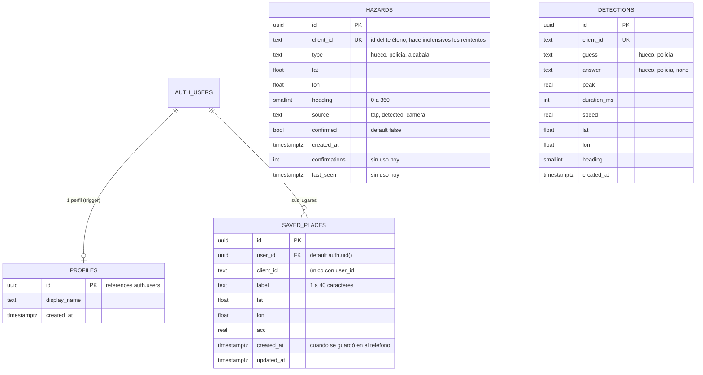

# Cuentas y esquema de Supabase

[← Índice](README.md) · Código: [auth/session.ts](../src/auth/session.ts) (puro, con tests),
[auth/ui.ts](../src/auth/ui.ts), [supabase/schema.sql](../supabase/schema.sql)

Supabase es el único backend. Es **opcional**: sin las variables `VITE_SUPABASE_URL` y
`VITE_SUPABASE_ANON_KEY` la app funciona igual, sin peligros compartidos, sin cuentas y sin
sincronización de lugares (la pestaña *Cuenta* lo dice y deshabilita el formulario).

## 1. Configuración

1. Crear un proyecto en supabase.com.
2. *SQL Editor* → pegar y correr [supabase/schema.sql](../supabase/schema.sql). Es **idempotente**: se puede
   correr de nuevo después de cada cambio.
3. *Project Settings → API*: copiar la URL y la clave pública (`anon`/`publishable`).
4. Local: copiar `.env.example` a `.env.local` con las dos variables y reiniciar `npm run dev`.
5. Vercel: las mismas dos variables de entorno (se hornean en el build), y volver a desplegar.
6. Auth → para que *Crear cuenta* entre directo hay que desactivar la confirmación por correo; con ella
   activa, la app muestra *Revisa tu correo para confirmar la cuenta*.

Nunca compartir ni poner en el cliente la clave `service_role`.

## 2. El cliente de cuentas

`createAuthClient({ config, fetch, storage, now })` habla con la API REST de Supabase Auth (GoTrue), sin
SDK. Recibe `fetch` y `storage` para correr igual en el navegador y en los tests.

| Acción | Llamada | Notas |
|---|---|---|
| Crear cuenta | `POST /auth/v1/signup` `{email, password, data: {display_name}}` | Valida correo y contraseña de ≥ 8 caracteres antes. Respuesta sin sesión ⇒ estado `needsConfirmation`. |
| Entrar | `POST /auth/v1/token?grant_type=password` | |
| Perfil | `GET /rest/v1/profiles?id=eq.<id>&select=display_name` | El nombre del perfil manda; si falla, el de `user_metadata`, si no la parte local del correo. |
| Renovar | `POST /auth/v1/token?grant_type=refresh_token` | Si faltan menos de 60 s para vencer (`REFRESH_MARGIN_MS`). Una a la vez. 400/401/403 ⇒ sesión cerrada; sin red ⇒ se mantiene y se reintenta. |
| Salir | `POST /auth/v1/logout` | Borra la sesión local primero. |

Estados (`AuthState`): `signedOut`, `working`, `needsConfirmation {email}`, `signedIn {session}`.
`subscribe(fn)` avisa cada cambio. La sesión (`accessToken`, `refreshToken`, `expiresAt`, `user {id,
email, displayName}`) se guarda en `localStorage['ar-nav.session']`; `restore()` la valida al abrir
(un token vencido se conserva porque el de renovación puede servir) y la renueva. Al volver a la app
(`visibilitychange`) se llama `ensureFresh()`.

Errores traducidos (`classifyError`, por `error_code` nuevo o texto viejo): correo o contraseña
incorrectos, correo ya registrado, contraseña débil, correo sin confirmar, demasiados intentos, sin
conexión, correo inválido, contraseña corta, servidor no configurado, genérico.

Cabeceras (`requestHeaders`): `apikey` siempre; `Authorization: Bearer` con el token del usuario, o con la
clave si es una anon vieja (JWT, empieza con `eyJ`). Las claves `sb_publishable_` nuevas no son JWT.

## 3. Qué usa la cuenta

- **Lugares guardados** sincronizados entre equipos ([lugares-guardados.md](lugares-guardados.md)).
- **Encontrar**: quien pide ver una ubicación manda el nombre de su cuenta; quien comparte lo ve como
  *Nombre sin verificar* (ver [encontrar.md](encontrar.md)).
- Los **peligros** no usan la cuenta: siguen siendo anónimos con la clave pública.

El trabajo de **login y onboarding** (pantallas de bienvenida y entrada) es de otra sesión en paralelo;
ver [trabajo-en-paralelo.md](trabajo-en-paralelo.md).

## 4. Seguridad

- La clave pública está en el cliente: las **políticas RLS** son la única protección.
- `profiles` y `saved_places` solo los ve y cambia su dueño (`auth.uid()`); `anon` no tiene permisos.
- `hazards`: lectura e inserción para `anon`; nadie edita ni borra desde la app (se corrige en el editor
  de tablas de Supabase).
- Los nombres que llegan por Encontrar se sanean (`sanitizeName`) porque cualquiera puede escribir
  lo que quiera en su `display_name`.

## 5. Esquema completo

| Tabla | RLS / permisos | Uso en la app |
|---|---|---|
| `hazards` | `anon`: `select`, `insert` | Peligros compartidos ([peligros.md](peligros.md)). |
| `detections` | `anon`: `insert` | **Ya no se escribe**: era para las respuestas a "¿Qué fue eso?", reemplazado por el botón de confirmar hueco. |
| `profiles` | `authenticated`: `select`, `update` del propio (`id = auth.uid()`) | Nombre visible. Una fila por usuario la crea el trigger `on_auth_user_created` → `handle_new_user()` (`security definer`, toma `raw_user_meta_data->>'display_name'`); el script también rellena usuarios anteriores. |
| `saved_places` | `authenticated`: `select`, `insert`, `update`, `delete` de los propios | Lugares guardados; `unique (user_id, client_id)` permite el *upsert* con `on_conflict=user_id,client_id`. Índice por `user_id`. |

Migraciones incluidas en el script: la columna `hazards.confirmed` (las filas `tap` viejas se marcan
confirmadas) y los bloques de cuentas y lugares. El script revoca todo a `anon`/`authenticated` y concede
explícitamente lo necesario, así funciona con o sin "exponer tablas nuevas automáticamente".
