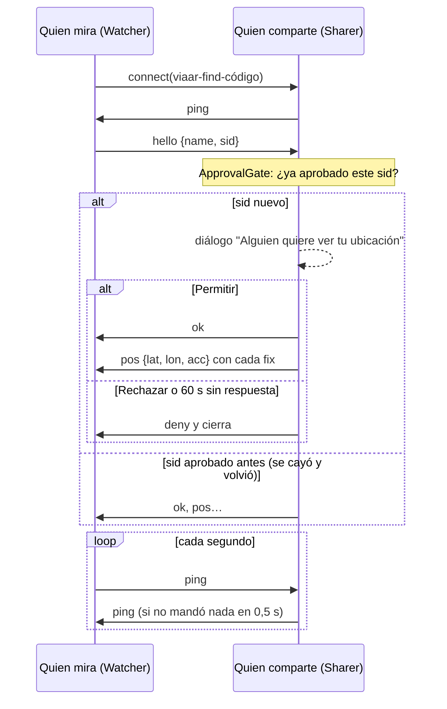

# Encontrar: compartir la ubicación en vivo

[← Índice](README.md) · Código: [find/protocol.ts](../src/find/protocol.ts) (puro),
[find/link.ts](../src/find/link.ts), [find/aim.ts](../src/find/aim.ts) (puro), [find/ui.ts](../src/find/ui.ts)

Una persona **comparte** su posición GPS con un código de 6 dígitos; otra la **ve** como un marcador
sobre la cámara, con la distancia. Es la pestaña *Encontrar* de la barra inferior. Los lugares guardados
ya no viven aquí: están en el mapa y en Ajustes ([lugares-guardados.md](lugares-guardados.md)).

## 1. Emparejamiento

Mismo esquema que el iPad: quien **muestra el código es dueño del id** de PeerJS y el otro lo llama.

- Quien comparte (`Sharer`) registra `viaar-find-<código>`, enciende su GPS y pide *wake lock* (con la
  pantalla dormida el navegador corta el GPS y el enlace). Si el id está tomado, saca otro código.
- *Enviar enlace* comparte `Mira dónde estoy en Vía AR: https://…/?comparte=123456` (hoja de compartir del
  sistema, o lo copia).
- Quien mira (`Watcher`) escribe el código o abre el enlace. Con `?comparte=` la pantalla se abre con el
  código ya escrito y **sin cámara**: iOS exige un toque para la cámara y el permiso de movimiento, así que
  *Ver ubicación* es ese toque.

## 2. Protocolo



| Mensaje | De → a | Contenido |
|---|---|---|
| `hello` | quien mira → quien comparte | `name` (el nombre de su cuenta o `null`), `sid` (128 bits al azar en hex, uno por sesión de *Ver*) |
| `ok` | → quien mira | Aprobado: empiezan las posiciones |
| `deny` | → quien mira | Rechazado; el canal se cierra 300 ms después |
| `pos` | → quien mira | `lat`, `lon`, `acc` en cada fix GPS, **solo después de `ok`** |
| `ping` | ambos | Latido, nunca lleva posición |

## 3. Reglas de privacidad

- **Nada de la ubicación sale antes de *Permitir*.** Los pings no llevan posición.
- **Un solo visor a la vez** (`ViewerSlot`): otra conexión se rechaza mientras el visor actual se haya
  oído en los últimos 6 s (`LOST_MS`).
- **Aprobación por sesión** (`ApprovalGate`): un `sid` aprobado vuelve a entrar sin preguntar si se cae
  la señal, mientras dure ese compartir. Un `sid` rechazado no vuelve a entrar.
- **60 s** sin respuesta al diálogo cuentan como rechazo. Con **3 rechazos** el compartir se detiene
  (alguien está adivinando o abusando del código) y hay que crear otro.
- **10 minutos** sin ningún visor (desde el inicio, o desde que el último se fue) y el código vence.
- Si quien mira no manda `hello` en 3 s, se lo trata como anónimo (con un `sid` nuevo).
- El nombre lo pone cada quien en su cuenta: se muestra como *Nombre sin verificar*, saneado
  (`sanitizeName`: máx. 40 caracteres visibles, una línea, sin caracteres de control ni de dirección
  de texto). Sin sesión dice *No ha iniciado sesión*.
- Todo lo que llega por el canal se valida (`parsePos`, `parseHello`): lat/lon finitos y en rango,
  `acc` ≥ 0, `sid` hexadecimal de 16 a 64 caracteres.
- *Dejar de compartir* o salir de la pantalla corta al instante.

Estados de quien comparte: *Conectando…*, *Esperando a que escriban el código o abran el enlace…*,
*Alguien pidió verte…*, *Te están viendo…*, sin conexión, código vencido, bloqueado por rechazos.
De quien mira: conectando, *Esperando que acepten…*, *Conectado: lo verás en la cámara*, señal perdida
(reconecta con espera creciente hasta 5 s), sin conexión, *Ese código no está activo* (id inexistente:
no reintenta), *No aceptaron compartir su ubicación*.

## 4. Dónde dibujar a la persona (`aim.ts`)

Modelo de cámara estenopeica de ángulo pequeño (el ladeo se ignora: el teléfono va derecho en la mano):

```
dist   = max(1 m, haversine(yo, persona))
rel    = angleDiff(rumbo de la cámara, bearing(yo, persona))      grados a la derecha
x      = W/2 + (W/2) · tan(rel) / tan(hfov/2)                     (detrás de la cámara: fuera de pantalla)
bajo   = atan(drop / dist) − pitch                                drop = 0,4 m: el pecho, no los pies
y      = H/2 + (H/2) · tan(bajo) / tan(vfov/2)
```

`lensOnScreen()` calcula `hfov`/`vfov` de lo que se ve con `visibleVfov()` (el mismo lente de 63° que la
calibración). El rumbo y la inclinación salen de `OrientationSensor`, suavizados. Si la persona no está
en pantalla (o queda detrás del panel inferior), el marcador se pega al borde más cercano con ‹ o ›.
La etiqueta dice "Persona · 120 m", más "±N m" si la precisión es peor que 15 m y "hace N s" si la
última posición tiene más de 15 s. Sin brújula absoluta solo se ve la distancia.

## 5. Límites

- Precisión del GPS: 3–10 m al aire libre, peor entre edificios altos; no sirve bajo techo ni en sótanos.
- Quien comparte debe dejar la pantalla encendida.
- Usa el broker público de PeerJS y sus TURN públicos (ver [enlace-ipad.md](enlace-ipad.md#6-red)): sin
  garantía de servicio.
- El código de 6 dígitos y la aprobación manual son la protección; no hay cifrado extremo a extremo propio
  más allá de DTLS de WebRTC.
