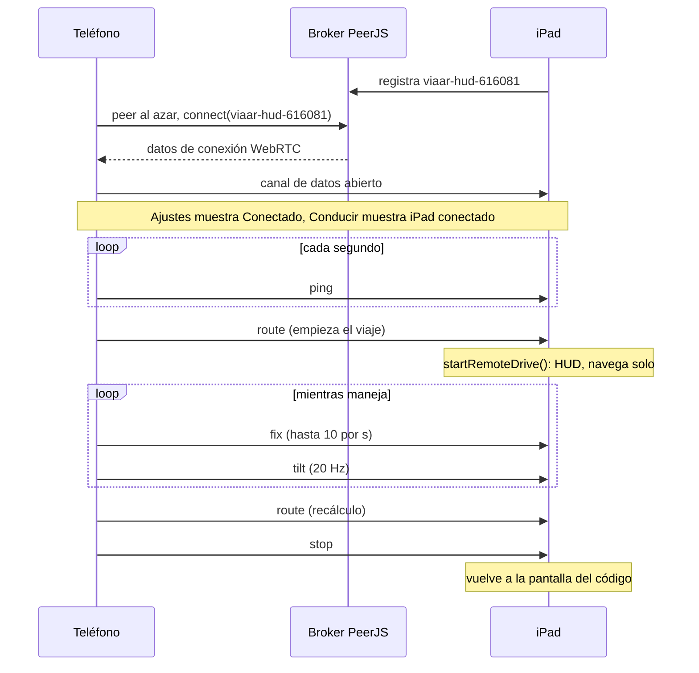

# Enlace teléfono ↔ iPad

[← Índice](README.md) · Código: [remote/protocol.ts](../src/remote/protocol.ts) (puro),
[remote/phoneLink.ts](../src/remote/phoneLink.ts), [remote/hudLink.ts](../src/remote/hudLink.ts),
[remote/orient.ts](../src/remote/orient.ts)

El teléfono corre la app y es la cámara; el iPad solo dibuja el HUD. Se enlazan con un código de 6
dígitos sobre un **canal de datos WebRTC** (PeerJS). No viaja video.

## 1. Emparejamiento

- El iPad toma un código (`newHudCode()`: 6 dígitos al azar, guardado en `ar-nav.hud.code` para que
  sobreviva a recargas) y registra en el broker de PeerJS el id **`viaar-hud-<código>`**. Lo muestra como
  `123 456`. Si el id está tomado (`unavailable-id`: otro equipo o su propia sesión vieja), saca otro.
- El teléfono escribe el código en *Ajustes → Dispositivos* (`normalizeCode` ignora espacios y guiones;
  exige 6 dígitos), toca *Conectar*: crea un peer con id al azar y llama a `viaar-hud-<código>` con
  `serialization: 'json'`.
- PeerJS (~89 KB minificado) se carga con `import()` solo al enlazar.
- En iPhone, *Conectar* pide el permiso de movimiento (dentro del toque); sin él, el enlace funciona
  pero el HUD no sigue el cabeceo del carro.

## 2. Mensajes

Todos van del teléfono al iPad (`RemoteMsg`). El iPad no responde.

| `t` | Campos | Cuándo |
|---|---|---|
| `route` | `pts: [lat, lon][]` (6 decimales), `steps: {kind, text, street, lat, lon, along}[]`, `duration`, `arrival: Arrival \| null` | Al empezar un viaje, en cada recálculo (`setRoute`) y al reconectar si hay un viaje en curso (`setDriveProvider`). |
| `fix` | `lat`, `lon`, `speed`, `heading`, `acc` | Cada cuadro como máximo cada 100 ms; si el fix GPS es el mismo, como máximo una vez por segundo. En Simulación sale ~10 por segundo. |
| `tilt` | `pitch`, `roll` (2 decimales) | Cada 50 ms (20 Hz), si hay una lectura de orientación de hace menos de 1,5 s. |
| `ping` | — | Cada segundo (`PING_MS`). |
| `stop` | — | Al tocar *Terminar*. |

`Arrival = { lat, lon, label, outline?, height? }`: el punto exacto elegido en la Maqueta, con la huella y
la altura del edificio (hoy el iPad solo usa el punto y la etiqueta).

`encodeRoute()`/`decodeRoute()` convierten `Route` a números planos y de vuelta (`buildPolyline` se
recalcula en el iPad). Tienen test de ida y vuelta.

La **inclinación** se calcula con `poseFromEuler(alpha, beta, gamma, upAngle)`, donde `upAngle` es el
"arriba" **físico** del teléfono según la gravedad (`physicalAngle`: múltiplos de 90°, ±35° de margen
para no parpadear, conserva el anterior si el teléfono está casi plano), no la orientación de la
interfaz. Así la inclinación es la misma con el bloqueo de rotación puesto o el teléfono de lado.

## 3. Qué hace el iPad con eso

- `fix` entra a `remoteGps` (`RemoteGpsSource`) con la hora de llegada del iPad.
- `route` → `onRoute`: si no hay viaje, `startRemoteDrive()`; si lo hay, `setRoute()` (recálculo).
- El iPad **navega por su cuenta** (`advance()` sobre la ruta recibida, con su propia carga de la
  maqueta, señales y peligros compartidos): un mensaje que llega tarde no congela el HUD, el
  movimiento entre fixes sale de la estimación.
- `tilt` alimenta `remoteTilt(now)` (vale 1,5 s), que usan la calibración automática (reposo) y
  `carAttitude()` (movimiento de la carrocería).
- El iPad no recalcula rutas: no tiene destino propio.

## 4. Pérdida y reconexión

| Lado | Regla |
|---|---|
| iPad | Cada segundo revisa: más de **5 s** (`LOST_MS`) sin ningún mensaje ⇒ *Se perdió el teléfono*. Sigue dibujando con lo último que tenía; si a los **15 s** no volvió, `stopRemoteDrive()` y vuelve al código. Un teléfono bloqueado no manda nada y WebRTC puede tardar ~30 s en notarlo, por eso el reloj propio. |
| iPad | Si el broker lo desconecta, `peer.reconnect()`. Una conexión nueva reemplaza a la anterior. |
| Teléfono | Si el canal se cierra o da error y el usuario sigue queriendo el enlace, estado *Reintentando…* y vuelve a llamar con espera creciente (1 s, 2 s… hasta 5 s). Al reconectar reenvía la ruta del viaje en curso. |
| Teléfono | *Desconectar* destruye el peer y deja de reintentar. |

Estados del teléfono (`LinkState`): `off`, `connecting` (*Conectando…*), `on` (*Conectado*, toast
*iPad conectado: seguirá cada viaje que empieces*), `lost` (*Reintentando…*).

## 5. Roles y salida

`?role=hud` o *Usar esta pantalla como HUD del parabrisas* guardan `ar-nav.role = 'hud'` y recargan.
*Usar como teléfono* guarda `'phone'` y recarga. El rol se decide una vez por carga de página.

## 6. Red

- Ambos equipos necesitan internet para el broker público de PeerJS (`0.peerjs.com`); los datos van
  después directo por WebRTC.
- `new Peer()` sin configuración usa la de PeerJS 1.5.5: STUN de Google (`stun.l.google.com:19302`)
  **y los TURN públicos de PeerJS** (`eu-0.turn.peerjs.com`, `us-0.turn.peerjs.com`). Los documentos
  anteriores decían "sin TURN"; en realidad hay un relay gratuito, sin garantía de servicio.
- Funciona en el mismo Wi-Fi o con el hotspot del iPhone. Un Wi-Fi que aísla clientes puede impedir la
  conexión directa.
- Seguridad: el código de 6 dígitos es el único secreto. Cualquiera que lo sepa y llegue primero puede
  mandar mensajes al iPad (no hay autenticación ni validación de los campos del mensaje más allá del
  tipo). Para una demo es aceptable; ver [limitaciones.md](limitaciones.md).

## 7. Historia

Antes, el teléfono enviaba su **video** a un laptop o iPad emparejado por QR ("cámara remota",
`display.ts`/`phone.ts`). Esa ruta se retiró; de ella quedan `orient.ts` (`uprightPlan`,
`interfaceAngle`, con tests) y `physicalAngle`, que sí se usa. [PLAN-HUD-AR.md](../PLAN-HUD-AR.md)
proponía Supabase Realtime para este enlace; se quedó en WebRTC/PeerJS.
