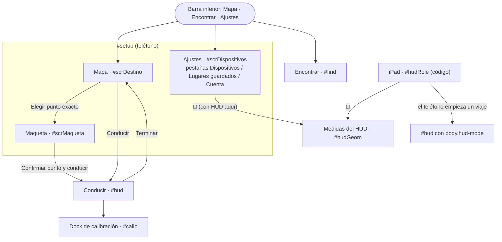

# Pantallas, flujos e interfaz

[← Índice](README.md)

Toda la interfaz está en [index.html](../index.html) (secciones fijas, mostradas y ocultadas con
`hidden`) y [src/style.css](../src/style.css). Tema oscuro grafito con azul `--pri: #3e6ae1` y fuente
Manrope. Hoy **solo hay tema oscuro**: `theme()` en `ui/destino.ts` y `ui/maqueta.ts` devuelve siempre
`'dark'`, aunque las paletas claras siguen en el código. Arriba a la izquierda hay una insignia `v2`.

## 1. Mapa de pantallas

`ui/shell.ts` cambia entre `destino`, `maqueta` y `dispositivos` con `go()`. *Encontrar* y *Conducir*
tapan `#setup` (lo ocultan) y lo vuelven a mostrar al salir.

## 2. Mapa (Destino)

| Elemento | Id | Qué hace |
|---|---|---|
| Mapa | `#map` | MapLibre con teselas vectoriales de OpenFreeMap en la paleta de la app; se carga la primera vez que se abre (~800 KB). Sin rotación ni inclinación. |
| *Desde* | `#from` | Vacío = "Mi ubicación actual". Al enfocarlo, el siguiente toque en el mapa pone ahí el origen (pin verde arrastrable). Escribir un origen o ponerlo en el mapa pasa el modo a **Simulación**: un viaje real solo empieza donde está el teléfono. |
| *¿A dónde vas?* | `#dest` | Dirección, coordenadas o enlace de Maps/Waze; se resuelve al cambiar. |
| ☆ | `#placesBtn` | Lista de lugares guardados con su distancia; tocar uno lo hace destino. |
| Caminar / Manejar | `#goWalk`, `#goDrive` | Caminar marca `#useSensors`: la vista sigue los sensores del teléfono. Se recuerda. |
| Guardar este lugar | `#savePlace` | Guarda la posición actual como "Lugar N" (sin GPS, el centro del mapa). |
| Recentrar | `#recenter` | Centra en la posición del teléfono. |
| Tarjeta de destino | `#dcTitle`, `#destLabel`, `#start` | Nombre, "N min · X km" de la vista previa, y el botón **Conducir** o **Elegir punto exacto** si el destino cae en una zona de la maqueta. |

Capas dibujadas: la cobertura de la maqueta (sus teselas teñidas, con un solo borde azul punteado por fuera), ruta de la vista previa, huecos (círculos
amarillos) y policías acostados (barras rosadas cruzadas sobre la calle: las de OSM de las teselas y
las reportadas). Las capas existen con `visible` en el código pero **no hay control en la interfaz
para apagarlas**. Tocar el mapa fija el destino ("Punto en el mapa") y después le pone el nombre de la
calle por geocodificación inversa.

## 3. Maqueta

Vista isométrica Three.js (cámara ortográfica a 35° de elevación) de la zona del destino: suelo, calles
de las teselas y edificios extruidos. Los 5 edificios más cercanos al destino llevan letras A–E; tocar
otro le asigna la siguiente letra. Se preselecciona el edificio que contiene el destino o el más
cercano. La tarjeta muestra "Edificio X · nombre", chips con las entradas (o *Frente al edificio* si no
hay entradas registradas) y **Confirmar punto y conducir**.

Gestos ([ui/maqueta.ts](../src/ui/maqueta.ts), `bindGestures`), siempre anclados bajo el dedo o el cursor:
un dedo o el ratón arrastra; dos dedos pellizcan, giran y arrastran a la vez; en Mac, pellizco y giro
del trackpad (Safari, eventos `gesture*`) o deslizar de lado con dos dedos (otros navegadores);
Ctrl/⌘/⌥/⇧ + arrastrar o el botón derecho giran. Botones: girar 90° (animado) y brújula (pone el norte arriba).

## 4. Conducir (`#hud`)

| Zona | Elementos |
|---|---|
| Arriba | Chip *iPad conectado* (si hay enlace), botón de calibración. |
| `#hudProjection` | Tarjeta de maniobra (glifo SVG girado según el giro, distancia, instrucción, calle), estadísticas (límite de velocidad de la maqueta, velocidad, restante "X km · N min"), *Llegaste* a menos de 20 m. Este bloque es el que recibe la homografía en el HUD. |
| Derecha | ⇄ ⇅ y 📐 (solo HUD; ⇄ ⇅ se ocultan con la óptica calculada), ⌖ alinear (solo con sensores), ● grabar. |
| Abajo | Botón redondo de **confirmar hueco** (aparece 8 s tras una detección, con un anillo de cuenta atrás), barra de velocidad de la simulación, tarjeta ETA (minutos, "Llegada: hh:mm · lugar", km) con *Pausar* (sim/repetición) y **Terminar**. |

No hay botones para reportar un hueco o policía acostado a mano: se quitaron el 25 oct (commit
`e01902c`, junto con el banner de peligro y el chip *Cámara fija*). El reporte es automático (ver
[peligros.md](peligros.md)).

Con `body.hud-mode` (HUD del parabrisas): fondo `#000`, sin video, sin chips, sin botones de la
izquierda, sin la parte de arriba de la ETA ni la barra de simulación; tipografía grande en blanco y
verde con resplandor.

### Dock de calibración (`#calib`)
Chips para cada valor (*Inclinación*, *Campo de visión*, *Altura cámara*, *Giro del soporte*,
*Posición en el carril*, *Ancho de la guía*, *Inicio de la guía*, y en Repetición *Sincronía video/GPS*),
un solo deslizador con − y +, *Restablecer*, *Más → Deshacer reporte* y *Listo*.
Ver [calibracion.md](calibracion.md).

## 5. Ajustes

**Dispositivos** (`#panDev`): campo del código del iPad con *Conectar/Desconectar* y chip de estado
(*Conectando…*, *Conectado*, *Reintentando…*); fila del teléfono (*Listo*); **CALIBRAR LA VISTA** con
una vista previa (la línea del horizonte se mueve con la inclinación) y los deslizadores *Altura de
vista* (`calib.height`) y *Horizonte* (`calib.pitch`); **MODO** Real / Simulación / Repetición (con los
dos archivos de la repetición); **OPCIONES** *Detectar huecos y policías acostados* (marcado por
defecto); **Avanzado**: *Pantalla de este equipo* (Cámara AR / HUD aquí), 📐 *Medidas del carro y del
iPad* y *Usar esta pantalla como HUD del parabrisas*.

**Lugares guardados** (`#panPlaces`): lista (más nuevo arriba) con nombre, distancia actual y fecha;
✎ renombrar en el lugar, *Ir* (lo hace destino y vuelve al mapa), ✕ borrar. Una línea dice el estado de
la sincronización con la cuenta. Ver [lugares-guardados.md](lugares-guardados.md).

**Cuenta** (`#panAccount`): *Entrar* / *Crear cuenta* (nombre, correo, contraseña de 8+ caracteres),
pantalla "Revisa tu correo para confirmar la cuenta", y con sesión: avatar con la inicial, nombre,
correo y *Cerrar sesión*. Sin servidor configurado, el formulario se deshabilita con un aviso.
Ver [cuentas-supabase.md](cuentas-supabase.md).

## 6. Encontrar (`#find`)

Cámara con un marcador sobre la persona que comparte su ubicación contigo, chip de precisión GPS y
aviso *Sin brújula*. Abajo: *Compartir ubicación* (tarjeta con el código, *Enviar enlace* y el estado),
*Ver a alguien* (campo del código y *Ver ubicación*). El diálogo *Alguien quiere ver tu ubicación*
muestra el nombre de quien pide (o *No ha iniciado sesión*) con *Permitir* / *Rechazar*.
Ver [encontrar.md](encontrar.md).

## 7. iPad (`#hudRole`)

"Pantalla HUD", el código grande (`123 456`), una línea de estado, 📐 *Medidas del carro y del iPad* y
*Usar como teléfono*. La hoja de medidas (`#hudGeom`) se describe en [optica-hud.md](optica-hud.md#8-la-hoja-de-medidas).

## 8. Flujos principales

**Conducir con punto exacto (zona de la maqueta).** Mapa → destino dentro del marco azul → *Elegir
punto exacto* → Maqueta: tocar edificio, elegir entrada → *Confirmar punto y conducir* →
`setDestination(entrada, arrival)` → vuelve al mapa y dispara *Conducir* → la ruta va a la entrada
(OSRM la ajusta a la calle) y la AR marca la entrada.

**Simulación desde otro origen.** Tocar *Desde* → tocar el mapa (o escribir) → el modo pasa a
Simulación → *Conducir*. La simulación recorre la ruta a la velocidad de la barra; donde hay maqueta,
la calle 3D reemplaza a la cámara.

**Repetición.** Ajustes → Modo → Repetición → elegir el video y su `.json` → *Conducir*. Si OSRM no
responde, el recorrido grabado se usa como ruta.

**Con iPad.** iPad: rol HUD → muestra el código. Teléfono: Ajustes → Dispositivos → escribir el código →
*Conectar* (en iPhone acepta el permiso de movimiento) → *Conectado*. Cada viaje que empiece el
teléfono aparece en el iPad; *Terminar* lo devuelve a su código.

**Compartir ubicación.** Encontrar → *Compartir ubicación* → *Enviar enlace* (o dictar el código) →
cuando alguien pide verte, *Permitir*. Quien recibe el enlace abre `/?comparte=123456`, que abre
Encontrar con el código escrito y sin cámara; *Ver ubicación* enciende la cámara.

**Guardar un lugar e ir.** Mapa → *Guardar este lugar* → más tarde ☆ o Ajustes → Lugares guardados → *Ir*.

**Compartir desde Google Maps o Waze (Android, app instalada).** *Compartir* → MapZ/Vía AR → abre con
`?url=`/`?text=` y el destino se resuelve solo.
