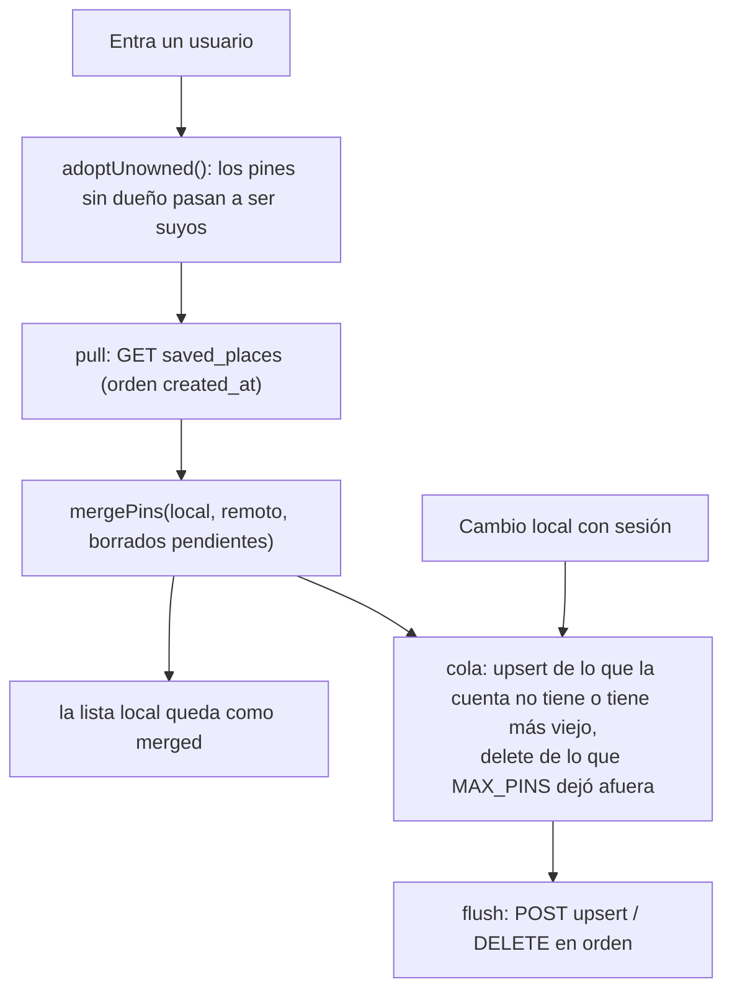

# Lugares guardados

[← Índice](README.md) · Código: [find/pins.ts](../src/find/pins.ts),
[find/pinsSync.ts](../src/find/pinsSync.ts) (puro con dependencias inyectadas),
[ui/syncPins.ts](../src/ui/syncPins.ts), [ui/lugares.ts](../src/ui/lugares.ts), `savePlace()` en
[ui/destino.ts](../src/ui/destino.ts)

"Dónde estacioné", la casa, la oficina. Se guardan en el teléfono y, con sesión iniciada, se reflejan en
la cuenta para verlos en otros equipos.

## 1. En la interfaz

- **Guardar**: botón del marcador en el mapa. Usa la posición actual; si el navegador no tiene GPS
  (un laptop), el centro del mapa ("sin GPS: en el centro del mapa"). Nombre automático *Lugar N*
  (el siguiente número libre).
- **Ver e ir**: pines en el mapa (tocar uno lo hace destino), el menú ☆ junto a *¿A dónde vas?* (con la
  distancia) y *Ajustes → Lugares guardados* (renombrar ✎, *Ir*, borrar ✕; la distancia se actualiza cada 3 s).
- **Máximo 8** (`MAX_PINS`): al guardar el noveno, se va el más viejo.

## 2. Modelo local

```ts
interface Pin { id: string;           // "pin-<Date.now()>"
                label: string;        // hasta 40 caracteres
                p: LatLon; acc: number | null; at: number; updatedAt?: number;
                owner?: string; }     // id del usuario; sin definir = hecho sin sesión
```

Todos en `localStorage['ar-nav.pins']`. Cada usuario que entra en el equipo ve **solo los suyos y los
sin dueño** (`visibleTo`); los de otros usuarios quedan guardados pero invisibles. `writeVisiblePins()`
reemplaza los visibles sin tocar los ajenos. Cada cambio hecho con sesión emite un `PinChange`
(`upsert` o `delete`) hacia la sincronización.

## 3. Sincronización con la cuenta



**Fusión** (`mergePins`): unión por id. Gana el `updatedAt` más nuevo (un empate gana la cuenta). Un
borrado pendiente nunca resucita el pin. Se ordenan por `at` y se quedan los 8 más nuevos; los que salen
y estaban en la cuenta se borran de ella.

**Cola** (`ar-nav.pins.outbox`): una operación por pin y usuario (la última gana: *upsert* y luego
*delete* deja solo el *delete*, y al revés). `flush()`:

| Respuesta | Qué pasa |
|---|---|
| 2xx | Se saca de la cola (solo si sigue siendo la misma op; una más nueva para el mismo pin queda). |
| sin red | Se detiene y guarda todo. |
| 401 | Renueva el token una vez y reintenta; si sigue, se detiene. |
| 408, 429, 5xx | Se detiene (transitorio). |
| otro 4xx | Se descarta esa op (el servidor nunca la aceptará) y sigue. |

- *Upsert*: `POST /rest/v1/saved_places?on_conflict=user_id,client_id` con
  `prefer: resolution=merge-duplicates,return=minimal`; la fila lleva `user_id`, `client_id`, `label`,
  `lat`, `lon`, `acc`, `created_at`, `updated_at`.
- *Delete*: `DELETE /rest/v1/saved_places?client_id=eq.<id>` (RLS limita al usuario).
- Las ops de un usuario nunca se mandan con la sesión de otro; esperan a que ese usuario vuelva a entrar.
- Se reintenta al volver la conexión, al volver a la app y en cada renovación del token.
- Estado mostrado: *Entra en Cuenta para guardar tus lugares en la nube*, *Sincronizando…*,
  *Sincronizado con tu cuenta*; oculto sin servidor configurado.

Todo esto tiene tests (fusión, cola, 401, usuarios A y B, adopción al entrar).
