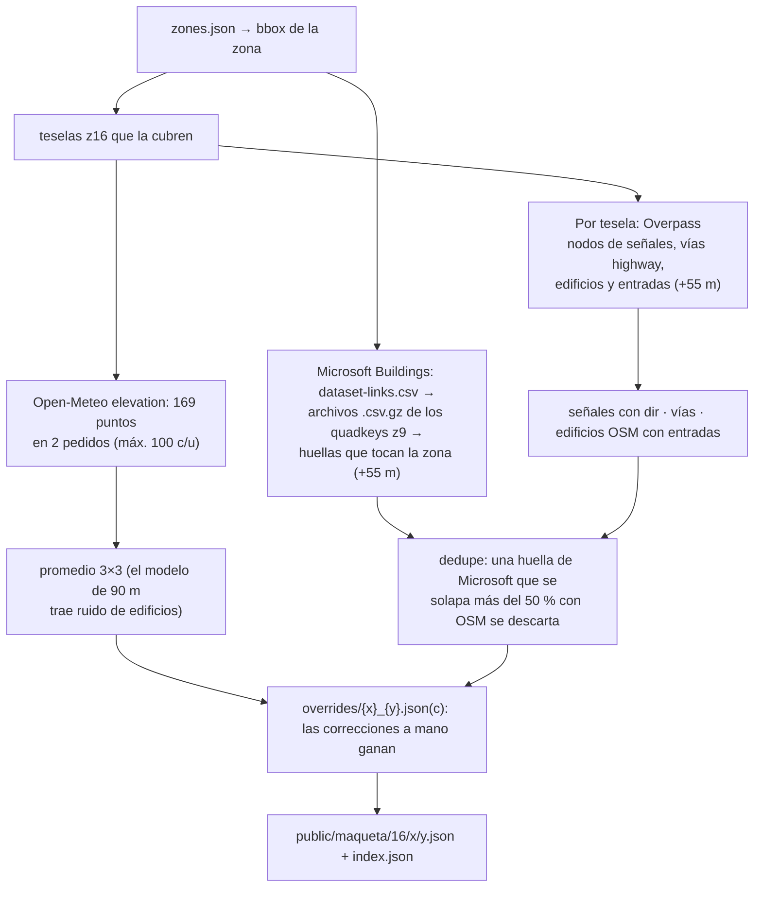

# La maqueta: teselas, edificios y punto exacto de llegada

[← Índice](README.md) · Plan original: [MAQUETA.md](../MAQUETA.md) · Código:
[core/maqueta.ts](../src/core/maqueta.ts), [scripts/maqueta/build.ts](../scripts/maqueta/build.ts),
[scripts/maqueta/buildings.ts](../scripts/maqueta/buildings.ts), [ui/maqueta.ts](../src/ui/maqueta.ts),
[render/scenery.ts](../src/render/scenery.ts)

La maqueta es nuestra propia capa de datos del mapa, **precompilada en teselas estáticas** en
`public/maqueta/`. La app solo lee esos archivos; nunca consulta Overpass ni Open-Meteo. Donde una ruta no
tiene teselas, todo funciona como antes: vía plana, sin señales ni límite de velocidad.

Da cinco cosas: **relieve** (la cinta sigue la pendiente; en la Av. San Juan Bosco ronda el 13 %),
**señales** (semáforos, PARE, CEDA, fotomultas, pasos peatonales, policías acostados), **límites de
velocidad**, **edificios** (pantalla Maqueta, calle 3D en Simulación) y **entradas** (punto exacto de llegada).

## 1. Formato

Teselas web estándar en **zoom 16** (unos 600 × 600 m en Caracas): `public/maqueta/16/{x}/{y}.json`.

```jsonc
{
  "v": 1,
  "tile": [16, 20597, 30843],
  "built": "2026-10-24T21:41:51.185Z",
  "sources": ["OpenStreetMap", "Copernicus DEM 90 m (Open-Meteo)", "Microsoft Global ML Building Footprints (ODbL)"],
  // Altura del suelo (m) en una rejilla regular en espacio de tesela: fila 0 = borde norte,
  // columna 0 = borde oeste, bordes incluidos. 13 × 13 = 169 puntos, ~50 m entre sí.
  "elev": { "rows": 13, "cols": 13, "z": [/* 169 valores */] },
  "signs": [{ "id": "osm:n123", "type": "traffic_signals", "lat": 10.51, "lon": -66.85, "dir": 143, "verified": false }],
  "ways": [{ "id": "osm:w456", "name": "Avenida San Juan Bosco", "oneway": true, "lanes": 2, "maxspeed": 30, "turnLanes": null, "pts": [[10.51, -66.85]] }],
  "buildings": [{ "id": "ms:10.510790,-66.852097", "name": null, "height": 9, "levels": null, "source": "ms",
                  "outline": [[10.5107, -66.8521] /* … anillo cerrado */], "entrances": [] }]
}
```

- `signs[].type`: `traffic_signals`, `stop`, `give_way`, `crossing`, `bump`, `hump`, `table`,
  `speed_camera`. `dir` = rumbo del tránsito al que aplica la señal (`null` = ambos sentidos);
  `verified` = vino de un override.
- `ways[].pts` van en el sentido de la vía (invertidos si OSM dice `oneway=-1`); `oneway` incluye
  las redomas; `maxspeed` en km/h (convierte mph).
- `buildings` es opcional (teselas viejas cargan igual). Cada edificio va **completo en la tesela que
  contiene su centro**; el contorno puede cruzar el borde.
- `source`: `osm`, `ms` (Microsoft), `google` (el tipo lo admite; el script no lo descarga) o `manual`.

`public/maqueta/index.json` lista las teselas hechas y las zonas:

```json
{ "v": 1, "zoom": 16, "tiles": ["20597/30843", "…"],
  "zones": [{ "name": "san-juan-bosco", "bbox": [10.509, -66.854, 10.5128, -66.8498], "tiles": ["20597/30843", "…"] }] }
```

`bbox` siempre es `[sur, oeste, norte, este]`.

## 2. Zonas construidas hoy

| Zona | Caja | Teselas | Edificios (OSM / Microsoft) | Señales |
|---|---|---|---|---|
| `san-juan-bosco` (Av. San Juan Bosco, Altamira) | 10.5090, −66.8540 → 10.5128, −66.8498 | 20597–20598 × 30843–30844 | 1 027 (186 / 841) | 24 PARE, 61 pasos, 9 semáforos, 2 CEDA, 9 *bump*, 8 *hump* |
| `altamira-sur` (Altamira sur, La Castellana y Chacao) | 10.4932, −66.8573 → 10.5040, −66.8463 | 20597–20598 × 30845–30846 | 822 (434 / 388) | 29 PARE, 220 pasos, 35 semáforos, 1 CEDA, 6 *bump*, 3 *hump*, 1 *table* |

Ningún edificio tiene entradas registradas todavía, y la mayoría de Microsoft no trae altura (quedan en
9 m). El mapa del Destino solo tiene nombre bonito para `san-juan-bosco` (`ZONE_LABEL` en
`ui/destino.ts`); `altamira-sur` se muestra con su nombre interno. Cubrir todo Chacao es trabajo en
curso de otra sesión (ver [trabajo-en-paralelo.md](trabajo-en-paralelo.md)).

## 3. El script que genera las teselas

```bash
npm run maqueta -- san-juan-bosco
```

Corre con `node --experimental-strip-types` (Node 22+), solo con `fetch`. Hace decenas de pedidos con
pausas de 1,5 s: se corre a mano y se hace commit del resultado, nunca en CI.



Detalles:

- **Overpass** (`[out:json][timeout:60]`, `out geom`): `node[highway~traffic_signals|stop|give_way|crossing|speed_camera]`,
  `node[traffic_calming~bump|hump|table]` y `way[highway~…]` (de motorway a service) en la caja de la
  tesela; `way/relation[building!=no]` y `node[entrance]` en la caja ampliada 0,0005° (~55 m). Cada nodo
  queda en una sola tesela.
- **Sentido de las señales** (`signDir`): `traffic_signals:direction` o `direction`. `forward`/`backward`
  siguen el sentido de la vía donde está el nodo; un número o N/NE/… es hacia dónde **mira** la señal,
  así que el tránsito al que aplica va al revés (+180°). Los pasos peatonales no llevan sentido.
- **Elevación**: Copernicus DEM 90 m vía `api.open-meteo.com/v1/elevation`. Los puntos de la rejilla salen
  de `gridPoint()`, la misma función que usa la app, para que coincidan.
- **Edificios OSM**: vías y multipolígonos `building=*` (los anillos exteriores se cosen con
  `stitchRings` y se toma el de más área). Entradas: nodos `entrance=*` que son vértices del contorno, o
  que caen dentro. Nombre: `name`, o "Entrada `ref`", *Entrada principal*, *de garaje*, *de servicio*, *Entrada*.
- **Microsoft Global ML Building Footprints** (ODbL): id estable `ms:{lat},{lon}` del centro de la huella
  con 6 decimales (`#2`, `#3`… si coinciden), para que los overrides los encuentren tras reconstruir.
- **Altura** (`buildingHeight`): `height` de OSM (acepta "12 m", "12,5", pies), si no
  `building:levels × 3 m`, si no la estimación del dataset si es positiva, si no **9 m**.
- **Duplicados** (`overlapShare`): muestreo 24 × 24 sobre la huella más chica; si la otra cubre más del
  50 %, gana OSM.
- El índice se fusiona: se agregan las teselas y la zona se reemplaza.

## 4. Correcciones a mano (overrides)

`scripts/maqueta/overrides/{x}_{y}.json` o `.jsonc` (JSON con comentarios `//`). Siempre ganan sobre
OSM, Microsoft y el modelo de elevación, y se aplican en cada reconstrucción.

```jsonc
{
  "signs":       [{ "id": "manual:1", "type": "stop", "lat": 10.5105, "lon": -66.8519, "dir": 350 }], // agrega o reemplaza (verified = true)
  "removeSigns": ["osm:n123"],                       // señales que OSM tiene mal
  "elev":        [{ "r": 4, "c": 7, "z": 968.5 }],   // alturas medidas de la rejilla
  "buildings":   [{ "id": "ms:10.510790,-66.852097", "name": "Torre B", "height": 24, "levels": 8,
                    "entrances": [{ "name": "Entrada 2", "lat": 10.51075, "lon": -66.85215 }] },
                  { "id": "ms:10.510432,-66.852367", "hide": true }],               // no es un edificio
  "addBuildings": [{ "id": "manual:kiosco", "name": "Kiosco", "height": 3,
                     "outline": [[10.5106, -66.85205], [10.51063, -66.85205], [10.51063, -66.85202]],
                     "entrances": [{ "name": "Ventanilla", "lat": 10.510615, "lon": -66.85202 }] }]
}
```

`buildings` cambia solo los campos que pongas (`name`, `height`, `levels`, `entrances`, `outline`) o
quita el edificio con `hide`. `addBuildings` entra con `source: 'manual'` (el anillo se cierra solo).
Si un id no existe en la tesela, la build avisa. Hay una plantilla **sin aplicar** con datos de relleno
en [overrides/ejemplo_20597_30843.jsonc](../scripts/maqueta/overrides/ejemplo_20597_30843.jsonc): para
usarla hay que renombrarla a `20597_30843.jsonc` y medir los datos. Hoy no hay ningún override aplicado.

## 5. Entradas y el punto exacto de llegada

`entrancesOf(building, ways)`:
1. Si el edificio tiene entradas (OSM u override), esas.
2. Si no, una calculada, **Frente al edificio**: busca la vía más cercana al contorno; muestrea el
   contorno cada metro; toma el punto más cercano a esa vía, y si toda una fachada corre a lo largo de
   la vía (dentro de 1 m de la distancia mínima), el **medio de esa fachada** (la racha más larga).
3. Sin entradas ni vías: ninguna ("No hay calle cerca para llegar a este edificio").

En la pantalla Maqueta, *Confirmar punto y conducir* produce
`Arrival { lat, lon, label: "Edif. B · Entrada 2", outline, height }` y el nombre del destino (el del
edificio o "Edificio B"). La ruta se pide **a la entrada** (OSRM la lleva a la calle más cercana), y la
AR pone el destino sobre la entrada misma, a la altura de la maqueta ([render-ar.md](render-ar.md#6-destino)).
El iPad recibe lo mismo en el mensaje `route`.

La Maqueta se abre cuando el destino cae dentro de la caja de una zona de `index.json` (`zoneAt()`); el
botón dice **Elegir punto exacto** en vez de *Conducir*.

## 6. Uso en la app durante un viaje

`loadRouteMaqueta(poly)` (al cambiar la ruta, en segundo plano):

1. Lee `index.json` (una vez) y, muestreando la ruta cada 25 m, las teselas que toca y existen (caché en memoria).
2. `elevationIn(tiles)`: altura bilineal **mezclada en los bordes** de teselas. Cada rejilla se suaviza
   por separado al construirla, así que dos vecinas pueden diferir metros en su borde común; a una
   celda (~50 m) de cada lado se ponderan ambas (1 dentro, 0,5 en el borde, 0 una celda afuera).
3. `RouteProfile.build(poly, elevationAt)`: altura cada ≤5 m, muestras parejas que terminan justo al
   final de la ruta; los huecos sin tesela toman la altura conocida más cercana (se leen planos).
   `profile.at(d)` interpola sin crear objetos.
4. `speedLimits(poly, ways)`: cada 10 m, la vía con `maxspeed` más cercana (≤12 m) que va en el sentido
   de la ruta (±35°; una de doble sentido también al revés). `limitAt()` devuelve km/h o `null`.
5. Señales (sin duplicados entre teselas) → `signs/` y los *bump/hump/table* → peligros de OSM.
6. Las teselas → `scenery` (calle 3D en Simulación).

`ArScene` usa `elevAlong(d) − elevAlong(along)` como altura de la cinta, los chevrones, la flecha, el
destino, los peligros y las señales, y suma la pendiente bajo el carro a la inclinación de la cámara.

## 7. Agregar una zona

1. Agregar `{ "name", "label", "bbox": [s, w, n, e] }` a [scripts/maqueta/zones.json](../scripts/maqueta/zones.json).
2. `npm run maqueta -- <name>` y revisar el resumen por tesela (señales, vías, edificios por fuente, alturas).
3. Opcional: overrides por tesela y volver a correr.
4. Agregar el nombre visible en `ZONE_LABEL` de `ui/destino.ts`.
5. `npm test`, `npm run build` y commit de `public/maqueta/` y `zones.json`.

## 8. Pendiente

- Nombres, alturas y entradas medidos (overrides).
- La malla invisible de edificios que solo escribe profundidad, para que la flecha de giro se oculte
  tras las esquinas (MAQUETA.md fase 4).
- Carriles: ancho de la cinta y `lateral` por tramo según `lanes`/`turn:lanes` (fase 3).
- Más zonas: Chacao completo (en curso), después el resto.
- **Aspecto de los edificios**: el experimento de fachadas
  ([experiments/fachadas/RESULTADOS.md](../experiments/fachadas/RESULTADOS.md)) recomienda fachadas
  procedurales en la pantalla Maqueta, alturas de Open Buildings 2.5D o 3D-GloBFP en el script (campos
  opcionales `use` y `heightSource`), y más adelante techos satelitales de OpenAerialMap (CC BY-NC) si el
  equipo acepta la licencia no comercial. Ninguno está hecho.
