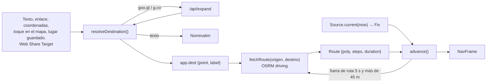

# Navegación: destino, ruta, seguimiento y recálculo

[← Índice](README.md)

Código: [core/links.ts](../src/core/links.ts), [core/route.ts](../src/core/route.ts),
[drive/sources.ts](../src/drive/sources.ts), [drive/navigation.ts](../src/drive/navigation.ts),
[drive/start.ts](../src/drive/start.ts), [walk/](../src/walk/).

## 1. Destino

`resolveDestination(raw)` en `core/links.ts`:

1. `parseInput()` busca una URL en el texto (sirve "Mira este lugar https://maps.app.goo.gl/abc").
2. **Waze**: `waze.com/ul/h<geohash>` (geohash decodificado), `ll=`, `latlng=`, `to=ll.<lat>,<lon>`, o `q=` como texto.
3. **Google corto** (`goo.gl`, `*.goo.gl`, `g.co`): `GET /api/expand?url=…`, que sigue hasta 6
   redirecciones solo por hosts de enlaces cortos de Google (no es un proxy abierto) y salta la
   página de consentimiento (`consent.*?continue=`). Después se vuelve a parsear el enlace largo.
4. **Google largo**: el pin `!3d<lat>!4d<lon>` (lo más preciso), luego `destination`, `daddr`, `q`,
   `query`, `ll`, `center`; luego `/dir/<origen>/<destino>`, `/place/<nombre>`, `/search/<texto>` y
   como último recurso el centro del mapa `@lat,lon`.
5. **Coordenadas sueltas** "10.48, -66.90".
6. **Texto**: Nominatim, primero con `countrycodes=ve` y luego sin filtro, en español.

Otras entradas: tocar el mapa (`ui/destino.ts`, nombre por geocodificación inversa con `zoom=18`),
un lugar guardado, la Maqueta (punto exacto, con `app.arrival`) o la Web Share Target de Android
(`?url=`, `?text=`, `?title=` al abrir, leídos en `initSetupScreen()`).

## 2. Ruta

`fetchRoute(from, to)` llama a `https://router.project-osrm.org/route/v1/driving/{lon},{lat};{lon},{lat}?steps=true&geometries=geojson&overview=full`.

- La geometría completa se convierte en `Polyline` (`buildPolyline`, con distancias acumuladas).
- Cada paso OSRM se convierte en `Step`: se saltan `depart` y los `continue`/`new name` rectos; la
  ubicación de la maniobra se proyecta sobre la polilínea (con `hint` creciente) para obtener `along`.
- `describe(type, modifier, exit)` da el texto: *Gira a la derecha*, *Mantente a la izquierda*,
  *En la redoma, toma la 2.ª salida*, *Incorpórate*, *Toma la rampa*, *Toma la salida*,
  *En la bifurcación, ve a la izquierda*, *Da la vuelta en U*, *Llegaste a tu destino*…
- Siempre hay un último paso `arrive` en el final de la polilínea.
- **Siempre perfil `driving`**, también con *Caminar*: el OSRM público no sirve rutas a pie.

`routeFromTrack(pts)` arma una ruta con un solo paso `arrive` desde un recorrido grabado (Repetición sin OSRM).

## 3. Fuentes de posición

| Modo | Fuente | Origen de la ruta | Cámara |
|---|---|---|---|
| **Real** (`gps`) | `GpsSource` (`watchPosition`, alta precisión, `maximumAge: 0`, `timeout: 20000`) | El primer fix (espera hasta 30 s: "El GPS no responde…") | Obligatoria, salvo con `display = 'hud'` |
| **Simulación** (`sim`) | `RouteSim`: avanza `speedKmh/3.6 · dt` sobre la ruta, rumbo = `bearingAt`, precisión 3 m | `app.from`, o lo escrito en *Desde* (resuelto), o la posición actual | Opcional |
| **Repetición** (`replay`) | `TrackReplay`: interpola el recorrido en `video.currentTime + syncOffset`; velocidad y rumbo del tramo | Primer punto del recorrido → destino (o último punto); si OSRM falla, el recorrido | El video grabado |
| iPad | `RemoteGpsSource`: los fixes del teléfono, con la hora de llegada | La ruta que manda el teléfono | No |

El grabador (●, solo en modo Real) guarda video y recorrido con el mismo reloj (`t` en segundos desde
el inicio): es el formato que lee la Repetición.

## 4. Seguimiento de la ruta: `advance()`

Por cuadro, en `drive/navigation.ts`:

1. **Proyección**: `project(poly, fix.p, hint)` da `along` (distancia sobre la ruta) y `dist` a la línea.
2. **Suavizado entre fixes** (el GPS llega a ~1 Hz):
   `predicted = pr.along + speed · min(2 s, now − fix.t)`. Si es el primer cuadro o el salto pasa de
   30 m, se toma tal cual; si no, `along += speed·dt` y luego `along += (predicted − along)·min(1, 3·dt)`.
   `along` se limita a `[0, largo]`.
3. **En ruta** si `dist < 25 m`: la posición se **pega** a la ruta (`pointAt(poly, along)`) y el rumbo
   objetivo es `bearingAt(poly, along, 15)`. Así la guía queda alineada con la calle aunque el GPS
   tiemble. Fuera de ruta se usan el fix crudo y `fix.heading` (o el rumbo anterior).
4. **Rumbo** suavizado: `app.yaw += angleDiff(app.yaw, objetivo) · min(1, 4·dt)` (~4 Hz).
5. **Próxima maniobra**: el primer paso con `along > along_actual + 3 m`.
6. **Origen de la cámara**: el punto del suelo desplazado `lateral` metros a la derecha
   (`offset(ground, yaw + 90, lateral)`; 1,6 m por defecto, porque la línea de OSM va por el centro de
   la calle).

`NavFrame = { origin, yaw, along, next, distToNext, remaining, speed, onRoute }`.

**Importante:** el rumbo de la cámara sale de la **ruta**, no de la brújula. Con el teléfono rígido en el
soporte es estable y barato. Solo con *Caminar* (`walk/view.ts`) la vista sigue los sensores.

## 5. Recálculo

Fuera de ruta (`dist ≥ 25 m`) se cuenta el tiempo. Se pide una ruta nueva cuando:
- lleva más de **5 s** fuera, **y** está a más de **45 m** de la línea,
- el modo es `gps`, hay `app.dest`, no hay otro recálculo en curso,
- pasaron al menos **10 s** desde el anterior.

Muestra *Recalculando ruta…*; la ruta nueva entra por `setRoute()`, que también la manda al iPad.
Si OSRM falla, sale un toast con el error y se reintenta en el siguiente intento elegible.
El iPad no recalcula nunca (no tiene `app.dest`): espera la ruta del teléfono.

Mientras está fuera de ruta, la tarjeta de maniobra dice *Fuera de ruta…*.

## 6. Modo degradado

En `frame()`: si el modo es `gps` y el fix tiene más de 3 s o `accuracy > 30 m`, `degraded = true`:
la cinta y los chevrones no se dibujan (pueden estar en un lugar equivocado); la flecha de giro, el
destino y la tarjeta de maniobra siguen. En el iPad aplica igual (sus fixes vienen del teléfono).

## 7. Caminar: la vista con sensores

Con *Caminar* (`#useSensors`), al empezar se pide permiso de orientación (iOS) y `updateView()` da
`{yaw, pitch, roll}` de la cámara trasera suavizados (`k = 10·dt`). `ArScene` usa ese rumbo y esa
inclinación en vez del rumbo de la ruta y la calibración. Si no hay brújula absoluta, avisa
*Sin brújula: toca ⌖ para alinear con la calle*; ⌖ guarda un sesgo para que la vista coincida con el
rumbo de la calle en ese momento. Sin lecturas en 3 s, vuelve al rumbo de la ruta.
No se usa en Repetición. La ruta sigue siendo de carro (ver [limitaciones.md](limitaciones.md)).

## 8. Tiempo restante y llegada

`renderHud()` estima los minutos como `duration · restante / largo` (mínimo 1) y la hora de llegada
con la hora local. *Llegaste* aparece a menos de 20 m del final; la tarjeta 3D del destino dice
*Llegada · N m* y *Llegaste* a menos de 8 m (ver [render-ar.md](render-ar.md#6-destino)).
