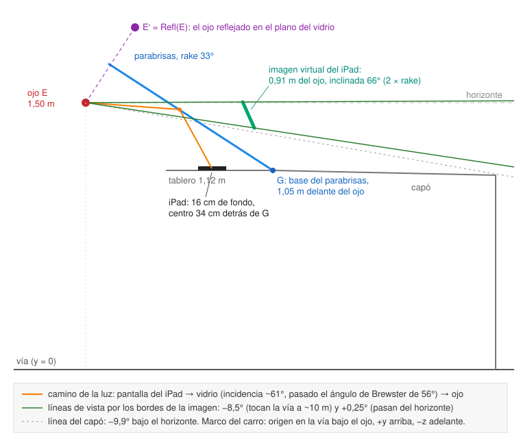
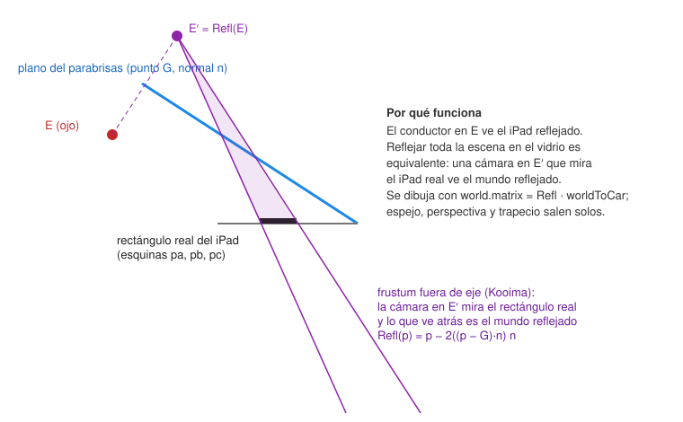

# Óptica del HUD del parabrisas

[← Índice](README.md) · Código: [src/render/optics.ts](../src/render/optics.ts) (puro, con tests),
[src/render/hudSetup.ts](../src/render/hudSetup.ts), `placeHudCamera()` en [src/render/ar.ts](../src/render/ar.ts)

## 1. El problema

El iPad va acostado sobre el tablero, pantalla arriba, en horizontal. El conductor ve su pantalla
**reflejada en el parabrisas**, encima de la calle. Para que la guía caiga sobre la calle real hay que
saber, para cada punto de la calle, en qué píxel del iPad dibujarlo. Un espejo CSS (`scale(-1, 1)`)
solo voltea la imagen; no corrige la perspectiva desde el ojo ni el **trapecio** que produce un vidrio
inclinado. `optics.ts` resuelve la geometría completa, y espejo, perspectiva y trapecio salen solos.



## 2. Marco del carro y medidas

Metros, ejes de Three.js, **origen en la vía bajo el ojo del conductor**: +x a la derecha, +y arriba,
+z hacia atrás (adelante es −z). Es el mismo marco local de la escena AR una vez girado al rumbo.

`HudGeometry` (guardada en `localStorage['ar-nav.hud.geometry']`):

| Campo | Significado | Fortuner 2015 |
|---|---|---|
| `eyeHeight` | Ojo sobre la vía | 1,50 m |
| `dashHeight` | Superficie de la pantalla del iPad sobre la vía | 1,12 m |
| `glassBase` | Distancia horizontal del ojo a la base del parabrisas (donde toca el tablero) | 1,05 m |
| `rake` | Ángulo del parabrisas desde la horizontal | 33° |
| `screenAhead` | Distancia horizontal del ojo al centro del iPad | 0,71 m (34 cm detrás de la base) |
| `screenLateral` | Centro del iPad a la derecha (+) del ojo | 0 |
| `topEdge` | Hacia dónde apunta el borde de arriba del iPad (el de arriba del canvas en horizontal) | `'driver'` |
| `cssPxPerInch` | Píxeles CSS por pulgada | 132 (iPad: 264 ppi / 2; iPad mini 163) |
| `hoodDeg` | Línea del capó, grados bajo el horizonte | 9,9° |
| `eyeDx`, `eyeDy` | Ajuste fino: mover el ojo supuesto | 0 |

Las medidas del preset son **estimadas** (no hay cifras oficiales de asiento y vidrio); hay que
reemplazarlas con cinta métrica en la hoja 📐.

`buildOptics(g, cssW, cssH)` arma con eso:

```
mpp = 0,0254 / cssPxPerInch                     metros por píxel CSS
E   = (eyeDx, eyeHeight + eyeDy, 0)             ojo
G   = (0, dashHeight, −glassBase)               punto del vidrio (su base)
n   = (0, −cos rake, sin rake)                  normal del vidrio, hacia la cabina
C   = (screenLateral, dashHeight, −screenAhead) centro del iPad
```

El iPad está acostado y en horizontal. Con el borde de arriba hacia el conductor, "derecha del canvas"
es la izquierda del carro y "arriba del canvas" es hacia atrás:

| `topEdge` | `u` (derecha del canvas) | `v` (arriba del canvas) |
|---|---|---|
| `'driver'` | (−1, 0, 0) | (0, 0, +1) |
| `'glass'` | (+1, 0, 0) | (0, 0, −1) |

Esquinas físicas: `pa = C − u·w/2 − v·h/2` (abajo-izquierda del canvas), `pb = pa + u·w`,
`pc = pa + v·h`, con `w = cssW·mpp`, `h = cssH·mpp` (el tamaño del canvas es `innerWidth × innerHeight`).

## 3. La reflexión

Reflexión en el plano que pasa por `G` con normal unitaria `n`:

```
Refl(p) = p − 2 ((p − G) · n) n
```

En forma de matriz 4×4 (`reflectMatrix`), con `d = G·n`:

```
| 1−2nx²   −2nxny   −2nxnz   2d·nx |
| −2nxny   1−2ny²   −2nynz   2d·ny |
| −2nxnz   −2nynz   1−2nz²   2d·nz |
|   0        0        0        1   |
```

Es su propia inversa y tiene determinante −1 (los tests lo comprueban). Three.js invierte el sentido de
las caras de los objetos cuya matriz tiene determinante negativo, así que el *culling* sigue bien.

Un iPad plano (horizontal) reflejado en un vidrio a `rake` grados queda inclinado `2·rake` respecto a la
horizontal: 66° en el Fortuner.

## 4. La cámara espejo

El conductor en `E` ve un píxel `s` del iPad en `Refl(s)`. Para que ese píxel tape un punto `p` de la
calle, `Refl(s)` tiene que estar en la recta `E → p`. Aplicando `Refl` a esa recta (es una isometría):
**`s` está en la recta `Refl(E) → Refl(p)`**. Es decir:

> Dibujar el **mundo reflejado** `Refl(p)` con una cámara en `E′ = Refl(E)` que proyecta sobre el
> **rectángulo real** del iPad da exactamente la imagen que el conductor necesita.



En `ArScene.placeHudCamera()`:

```
world.matrix = Refl · worldToCar
worldToCar   = Rz(roll) · Rx(pitch) · Ry(yaw)      rumbo y actitud de la carrocería
cámara       = mirrorCamera(optics) = offAxis(E′, pa, pb, pc, near 0,3, far 3000)
```

La cámara se queda fuera del grupo `world` (no se refleja). La matriz de la cámara y su proyección se
calculan una vez por óptica (`matrixAutoUpdate = false`); cada cuadro solo cambia `world.matrix`.

### Proyección fuera de eje (Kooima)

"Generalized perspective projection" de Robert Kooima: una cámara en `e` que mira un rectángulo con
esquinas `pa` (abajo-izq.), `pb` (abajo-der.), `pc` (arriba-izq.):

```
vr = norm(pb − pa)     vu = norm(pc − pa)     vn = norm(vr × vu)
va = pa − e            vb = pb − e            vc = pc − e
d  = −va · vn                                  distancia del ojo al plano (debe ser > 0)
k  = near / d
left = (vr·va)·k   right = (vr·vb)·k   bottom = (vu·va)·k   top = (vu·vc)·k
projection  = makePerspective(left, right, top, bottom, near, far)
matrixWorld = base (vr, vu, vn) con origen en e
```

Como el rectángulo es el iPad real, el canvas del iPad **es** la ventana de esa cámara: el píxel (x, y)
de la imagen renderizada cae en el píxel (x, y) de la pantalla física.

### Qué espejo sale

Los tests comprueban con puntos de la calle que:
- borde de arriba **hacia el conductor** ⇒ la derecha de la calle se dibuja a la izquierda (espejo
  horizontal, lo que aproximaba el botón ⇄) y lo lejano más arriba;
- borde de arriba **hacia el vidrio** ⇒ izquierda y derecha se mantienen y lo lejano queda más abajo
  (volteo vertical, lo que aproximaba ⇅);
- en ambos casos, además, el trapecio que un volteo CSS no da.

### Comprobación independiente

`worldToCss(o, p)` hace lo mismo por trazado de rayos, sin matrices: rayo `E → p`, lo corta con el plano
del iPad reflejado, refleja el punto de corte de vuelta a la pantalla física y lo pasa a píxeles CSS
(`x = (q − pa)·u / mpp`, `y = cssH − (q − pa)·v / mpp`). El test compara 200 puntos de la calle y por
encima de ella: las matrices de render coinciden con el trazado de rayos a menos de 0,01 px.

## 5. La imagen virtual (`virtualImage`)

Se reflejan las 4 esquinas y el centro del iPad y se miden desde el ojo:

| Valor | Cómo |
|---|---|
| `distance` | `|Refl(C) − E|` |
| `centreDeg`, `lowDeg`, `highDeg` | elevación del centro y de las esquinas (+ = sobre el horizonte) |
| `widthDeg` | diferencia de azimut entre esquinas |
| `tiltDeg` | inclinación del eje de la pantalla reflejada que no es horizontal |
| `incidenceDeg` | `acos(|dir · n|)` del rayo central (el ángulo de Brewster del vidrio es ~56°; por encima refleja más) |
| `roadFrom`, `roadTo` | `eyeHeight / tan(−ángulo)` de los bordes bajo el horizonte; `Infinity` sobre él |
| `hoodClear` | el borde de abajo queda por encima de la línea del capó |

Números del preset Fortuner con un iPad de 11″ en horizontal (1194 × 834 px CSS = 0,230 × 0,160 m),
calculados con el código actual:

| | Valor |
|---|---|
| Distancia de la imagen al ojo | 0,914 m |
| Ojo reflejado `E′` | (0; 1,925; −0,276) m |
| Centro de la imagen | −4,35° (bajo el horizonte) |
| Bordes | −8,53° … +0,25° |
| Ancho | 14,9° |
| Inclinación de la imagen | 66° (2 × 33°) |
| Incidencia en el vidrio | 61,4° |
| Vía cubierta | desde ~10,0 m hasta el horizonte |
| Libre del capó | sí (−8,5° > −9,9°) |
| Ubicación aconsejada | centro del iPad 34,8 cm detrás de la base → imagen centrada a −3,94° |

## 6. El texto (homografía)

La velocidad, la distancia y la próxima maniobra (`#hudProjection`) se maquetan con CSS normal y luego
reciben una transformación `matrix3d` para leerse **derechas y sin deformar en el vidrio**
(`panelTransform(o, fill = 0.9)`):

1. Plano de vista del conductor: pasa por el centro de la imagen reflejada, de frente al ojo, con ejes
   "derecha" y "arriba" del conductor.
2. Las 4 esquinas reflejadas del iPad, vistas desde el ojo, se proyectan en ese plano: un cuadrilátero
   (trapecio) en metros.
3. Se busca por bisección (40 pasos) la caja más grande con la proporción del canvas, centrada, que cabe
   dentro del cuadrilátero, y se usa al 90 %.
4. Las esquinas de esa caja se llevan de vuelta al canvas con `worldToCss` (extendiendo la línea de
   vista para que corte la pantalla reflejada).
5. La homografía 3×3 que lleva el rectángulo CSS a esas 4 esquinas sale de un sistema 8×8 resuelto por
   eliminación gaussiana con pivoteo parcial.
6. Se escribe como `matrix3d` (columna mayor, `transform-origin: 0 0`), actuando sobre (x, y, 1).

Con la óptica activa, `applyHudView()` anula el espejo CSS (`--mirror-x: 1`, `--flip-y: 1`), porque el
canvas ya sale espejado de la proyección, y oculta los botones ⇄ ⇅. Un test verifica que la caja queda
dentro de la pantalla y que se lee derecha y sin espejo desde el ojo.

## 7. Actitud del carro

En el iPad, la carrocería cabecea (frenadas) y se ladea. El teléfono va rígido en su soporte, así que su
inclinación menos su inclinación en reposo es el movimiento del carro. En `main.ts`:

```
objetivo = inclinación del teléfono (remoteTilt) − (calib.pitch, mountRoll)   reposo medido por la calibración automática
k        = min(1, dt · 2π · 3)                                                 paso bajo de ~3 Hz
actitud += (objetivo − actitud) · k
```

El teléfono manda su inclinación a 20 Hz referida a su "arriba" físico (`physicalAngle`), y el reposo se
mide en el iPad con la misma ventana quieta que la calibración automática (ver
[calibracion.md](calibracion.md#3-calibración-automática)). La inclinación del propio iPad nunca se usa:
va acostado en el tablero. Sin teléfono enlazado (HUD en un solo equipo), la actitud es 0.

## 8. La hoja de medidas

📐 *Medidas del carro y del iPad* (`#hudGeom`), desde el HUD, desde la pantalla de código del iPad o desde
*Ajustes → Avanzado* con *HUD aquí*:

- **Carro**: preset *Toyota Fortuner 2015 (medidas estimadas)* o *Personalizado* (cambia solo al editar).
- **Campos** en cm o grados: altura de los ojos, altura del tablero, ojos → base del parabrisas,
  inclinación del parabrisas (con **Medir**), centro del iPad → base del parabrisas, iPad a la derecha
  de los ojos.
- **Medir**: apoyar el equipo plano sobre el vidrio; durante 1,5 s toma `acos(|cos β · cos γ|)` de los
  eventos de orientación (el ángulo del plano de la pantalla con la horizontal, apoyado como sea) y usa
  la mediana. Pide permiso de movimiento en iOS.
- **Borde de arriba del iPad**: hacia mí / hacia el parabrisas.
- **Lectura en vivo**: distancia, ancho y tramo de vía que cubre la imagen.
- **Consejo de ubicación** (`placementAdvice`): prueba posiciones del iPad cada 2,5 mm entre 0,3 m del
  ojo y la base del vidrio (menos medio iPad) y elige la que centra la imagen a −4° (vía a ~20 m);
  dice cuánto acercar o alejar y ofrece *Usar*.
- **Avisos**: la parte baja queda detrás del capó; la imagen no llega al horizonte; de día el reflejo es tenue.
- **Ajuste fino** mirando el reflejo en una calle recta: mover el ojo supuesto ±15 cm arriba/abajo y
  ±40 cm a los lados.
- **Óptica calculada** (recomendado, encendida por defecto). Apagada vuelve al espejo simple ⇄ ⇅.

## 9. Espejo simple

Con *Óptica calculada* apagada, `applyFlip()` pone `--mirror-x` / `--flip-y` a −1 según
⇄ ⇅, y CSS aplica `scale(var(--mirror-x), var(--flip-y))` al canvas y al texto. La cámara es la de la
AR normal con el perfil de calibración del HUD (`ar-nav.calib.hud.*`: inclinación 8°, FOV 45°, altura
1,2 m, cinta de 3,2 m).

## 10. Límites conocidos

- **Paralaje**: la imagen está a ~0,9 m del ojo, no en la calle. Solo coincide desde el ojo supuesto;
  mover la cabeza unos cm desplaza la guía. No hay seguimiento de cabeza.
- **Doble imagen**: un parabrisas laminado refleja en sus dos caras.
- **Contraste de día**: el reflejo de una pantalla en vidrio sin película es tenue; las primeras
  pruebas deben ser al atardecer o de noche.
- **Sprites**: las etiquetas de peligros y la tarjeta del destino no se dibujan con la óptica (los
  sprites no se reflejan con el mundo), y hoy no hay banner de texto que las reemplace.
- **Ancho de la cinta**: 3,2 m llena buena parte de una imagen de ~15° entre 10 y 20 m.
- Las medidas del preset son estimadas; falta una prueba en carro con medidas reales (ver
  [trabajo-en-paralelo.md](trabajo-en-paralelo.md)).
