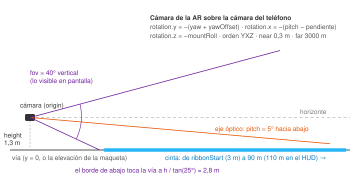

# Pipeline de render AR

[← Índice](README.md) · Código: [src/render/ar.ts](../src/render/ar.ts),
[signMarkers.ts](../src/render/signMarkers.ts), [scenery.ts](../src/render/scenery.ts),
[hud.ts](../src/render/hud.ts)

## 1. La idea

Un **cámara virtual** de Three.js se pone donde está la cámara real del teléfono (o, en el HUD, donde
está el ojo del conductor reflejado en el vidrio) y dibuja la geometría de la ruta en un canvas
transparente (`alpha: true`, `setClearColor(0, 0)`) encima del `<video>` de la cámara. Si la cámara
virtual coincide con la real, la cinta cae sobre el asfalto.

- La **posición** viene de la navegación: el punto del suelo bajo la cámara (`NavFrame.origin`), pegado
  a la ruta cuando está en ruta. La escena se arma cada cuadro en un marco local ENU centrado en ese
  punto (`toLocal(origin, p)`: x este, z sur, y arriba).
- El **rumbo** es el de la ruta (o el de los sensores con *Caminar*). No se lee la brújula al manejar.
- La **inclinación**, el **ladeo** y el **campo de visión** son constantes del soporte, calibradas
  ([calibracion.md](calibracion.md)).
- La **altura** de cada cosa sale del perfil de elevación de la maqueta (`elevAlong(d) − elevAlong(along)`)
  o es 0 (vía plana) donde no hay teselas.



## 2. El contrato `FrameInput`

`ArScene.update(f: FrameInput)` se llama una vez por cuadro desde `main.ts`:

| Campo | Qué es |
|---|---|
| `origin`, `yaw` | Punto del suelo bajo la cámara y rumbo (grados desde el norte). |
| `poly`, `along` | Polilínea de la ruta y posición sobre ella (m). `poly = null` limpia la escena. |
| `next`, `distToNext` | Próxima maniobra y distancia a ella. |
| `hazards` | Peligros a dibujar (`HazardView[]`, ya filtrados por `hazards/ahead.ts`). |
| `calib` | `pitch`, `fov`, `height`, `yawOffset`, `lateral`, `ribbonWidth`, `ribbonStart`. |
| `pose?` | Con *Caminar*: `{pitch, roll}` de los sensores, en lugar de la calibración. |
| `display?` | `'camera'` o `'hud'`. |
| `degraded?` | GPS malo: no se dibuja la cinta. |
| `mountRoll?` | Ladeo del soporte medido (grados). |
| `optics?` | Óptica del parabrisas (`Optics`) cuando el HUD usa la óptica calculada. |
| `attitude?` | Cabeceo y ladeo de la carrocería (solo HUD con óptica). |
| `elevAlong?` | Altura de la vía a `d` metros de la ruta (perfil de la maqueta). |
| `signs?` | Señales viales de la maqueta delante. |
| `arrival?` | Punto exacto de llegada (una entrada): el destino se dibuja ahí. |
| `destLabel?` | Nombre en la tarjeta del destino. |
| `scenery?` | Teselas para la calle 3D de fondo (solo Simulación, solo cámara). |

## 3. La cámara

`PerspectiveCamera(fov, aspect, near 0.3, far 3000)` con `rotation.order = 'YXZ'`:

```
position   = (0, calib.height, 0)
rotation.y = −(yaw + yawOffset)
rotation.x = −(pose ? pose.pitch : calib.pitch − pendiente)
rotation.z = −(pose ? pose.roll  : mountRoll)
fov        = calib.fov   (vertical, de lo que se ve en pantalla)
```

`pendiente` (`gradeDeg`) es el ángulo de la vía bajo el carro según la maqueta, medido entre 8 m atrás y
8 m adelante: un soporte rígido se inclina con el carro, así que en una subida la cámara mira más arriba
respecto al mundo. Con los sensores la inclinación ya es absoluta y no se corrige.

En el HUD con óptica, la cámara se reemplaza por la matriz fuera de eje de la óptica y el mundo se
refleja (ver [optica-hud.md](optica-hud.md)). La cámara vive fuera del grupo `world`: el mundo se
refleja, la cámara no. Una luz direccional va pegada a la cámara (arriba a la izquierda) más una luz de
cielo, para que los frentes estén siempre iluminados.

## 4. La cinta y los chevrones (`updateRibbon`)

- **Muestras** cada 2 m (`RIBBON_STEP`) desde `along + ribbonStart` hasta `along + 90 m` (110 m en el
  HUD), más una última exacta en el final si la ruta termina antes. Buffers preasignados
  (`Float32Array` de `MAX_SAMPLES`): no se crean objetos por cuadro.
- **Dirección** promediada ±5 m (`CORNER_SMOOTH`): las esquinas quedan redondeadas y la banda no se
  dobla sobre sí misma. Ancho `ribbonWidth` (3 m por defecto; 3,2 m en el HUD).
- **Color**: cian `(0.3, 0.82, 1)` con α 0,5 sobre la cámara; verde `(0, 0.9, 0.46)` con α 0,92 en el
  HUD. Uniforme y solo se desvanece en los últimos 8 m. Un aro marca dónde termina la banda si la ruta
  sigue.
- **Llegada dentro de la banda**: en los últimos 40 m la banda y los chevrones pasan al verde del
  destino (sobre la cámara), la banda corta en seco y una **línea de meta** a cuadros (bloque de 3 m de
  largo y 0,3 m de alto) la cruza.
- **Chevrones** pintados sobre la banda en puntos fijos cada 5 m (así "corren" al avanzar): 82 % del
  ancho, 2,4 m de largo. Donde la vía gira respecto a la vista (de 18° a 32° de diferencia) se
  desvanecen, porque vistos de canto parecen apuntar a otro lado; ahí manda la flecha de giro.
- **Modo degradado**: no se dibuja nada de esto.

## 5. La maniobra (`updateTurn`)

- **Flecha de giro** de pie en el punto de la maniobra, desde 300 m antes, siempre de frente al
  conductor y algo girada hacia la calle nueva. Una flecha extruida por tipo de giro (derecho, leve,
  normal, fuerte, vuelta en U), con biseles y contorno oscuro. Aparece con un "pop", se encoge en los
  últimos 5 m pasado el giro, y a menos de 80 m se mece hacia donde hay que ir. Anillos pulsantes en el suelo.
- **Escala legible** (`readableScale`): nunca ocupa menos del 8 % de la altura de la pantalla
  (máx. ×5), usando el FOV de la cámara o el ángulo vertical de la imagen del HUD.
- **Señales de curva**: 4 paneles translúcidos con chevrones que se encienden en ola hacia el giro, de
  pie al otro lado del cruce (7 m pasado el punto), desde 200 m antes. Solo en giros reales
  (izquierda/derecha normales o fuertes), no en bifurcaciones ni vueltas en U.

## 6. Destino

Cuando la próxima maniobra es `arrive` (desde 500 m), en el punto exacto (`arrival`) o el final de la ruta:
un **resplandor** verde en el suelo (aditivo, radio 3,2 m), anillos que se expanden, un **pin** con
bandera que flota y se balancea de frente al conductor, con su sombra, y una **tarjeta** (sprite) con
el nombre y *Llegada · N m* (redondeado a 5 m bajo 100 m, a 10 m encima) o *Llegaste* bajo 8 m. Si
encima del pin no cabe, la tarjeta se pone al lado de la cabeza del pin, del lado con más espacio.
El edificio de destino no se resalta (dibujado sobre el overlay se veía a través de los de delante).

Con la óptica del HUD la tarjeta no se dibuja: los sprites miran siempre a la cámara y no se reflejan
con el mundo.

## 7. Peligros (`updateHazards`)

Pool de 10 marcadores. Llegan ya filtrados: a menos de 20 m de la ruta, en nuestro sentido, entre 8 m
atrás y 220 m adelante ([peligros.md](peligros.md#6-en-la-ruta)).

- **Hueco** (y alcabala): cono rojo con banda blanca y base, anillo rojo pulsante.
- **Policía acostado**: la propia joroba cruzando el carril (medio cilindro de 3,6 m de ancho, 1,2 m de
  largo y 0,2 m de alto, a rayas amarillas y negras), colocada sobre la línea de la ruta y girada con
  ella, con anillo ámbar.
- **Etiqueta** (sprite *HUECO*, *POLICÍA ACOSTADO*, *ALCABALA*). Se oculta con la óptica del HUD. Hoy el
  HUD no tiene otro aviso de peligro: el banner de texto se quitó el 25 oct (ver
  [limitaciones.md](limitaciones.md)).

## 8. Señales viales (`SignMarkers`)

Pool de 12. De la maqueta, ya filtradas por `signs/ahead.ts` (a ≤15 m de la ruta, sentido compatible,
de 8 m atrás a 180 m adelante). PARE (octágono), CEDA (triángulo) y FOTOMULTA (cuadro azul) flotan a
2,4 m sobre la vía; los semáforos (caja con tres luces tenues: no sabemos cuál está encendida) a 3,2 m.
Van 4,5 m a la derecha de la línea de la ruta, de frente a quien viene por ella, y crecen hasta ×2,2
con la distancia. Los pasos peatonales no se dibujan (la pintura real está ahí) y los policías
acostados de OSM van como peligros.

## 9. La calle 3D de la maqueta en Simulación

En modo Simulación con pantalla de cámara, si el carro está dentro de una tesela, `Scenery` dibuja
primero un fondo opaco y después el overlay encima (`renderer.render(scenery.scene, camera)`,
`clearDepth()`, `render(scene, camera)`):

- **Relieve**: una malla por tesela 4× más fina que su rejilla de elevación, con la misma función
  `elevationIn()` que el perfil de la ruta (mezcla en los bordes de teselas).
- **Calles**: cada vía una vez, como franja de `max(3, carriles·3,2/2)` m a cada lado, muestreada cada
  8 m y apoyada en el suelo (se inclina con la pendiente), con línea central en las de doble sentido.
- **Edificios**: extruidos desde el punto más bajo del suelo bajo su huella hasta su altura sobre el
  más alto, todos en una sola malla, con paredes más oscuras abajo y techo claro.
- Cielo azul marino con niebla de 70 a 460 m. Se construye una vez por ruta en un marco local centrado
  en la primera tesela y cada cuadro solo se desliza bajo el carro (`place()`), con la altura base del
  perfil de la ruta para que cinta y calle coincidan.

Fuera de las teselas vuelve la cámara. No se usa en el HUD.

## 10. El HUD de texto (`render/hud.ts`)

`renderHud(HudInput)` actualiza el DOM solo si el texto cambió (`setText`): glifo SVG de la maniobra
(rotado según el giro; pin para la llegada, U para la vuelta), distancia, instrucción y calle,
velocidad en km/h, límite de la maqueta (oculto si no se sabe), restante y minutos, la tarjeta ETA y
*Llegaste*. En el HUD, el restante se oculta. `nearestHazard` llega en `HudInput` pero hoy no se muestra.

En el HUD con espejo simple, `--mirror-x` y `--flip-y` (CSS) voltean el canvas y el texto juntos; con la
óptica calculada, el canvas ya sale espejado de la proyección y el texto recibe una homografía
`matrix3d` (ver [optica-hud.md](optica-hud.md#6-el-texto-homografía)).

## 11. Rendimiento

- `setPixelRatio(min(devicePixelRatio, 2))`.
- Geometrías y materiales creados una vez; pools fijos para chevrones (22), señales de curva (4), señales viales (12), peligros (10).
- La cinta escribe en buffers preasignados y solo cambia el `drawRange`.
- La calle 3D se construye una vez por ruta.
- Las texturas de texto (tarjeta del destino, etiquetas) se redibujan solo cuando cambia el texto.
