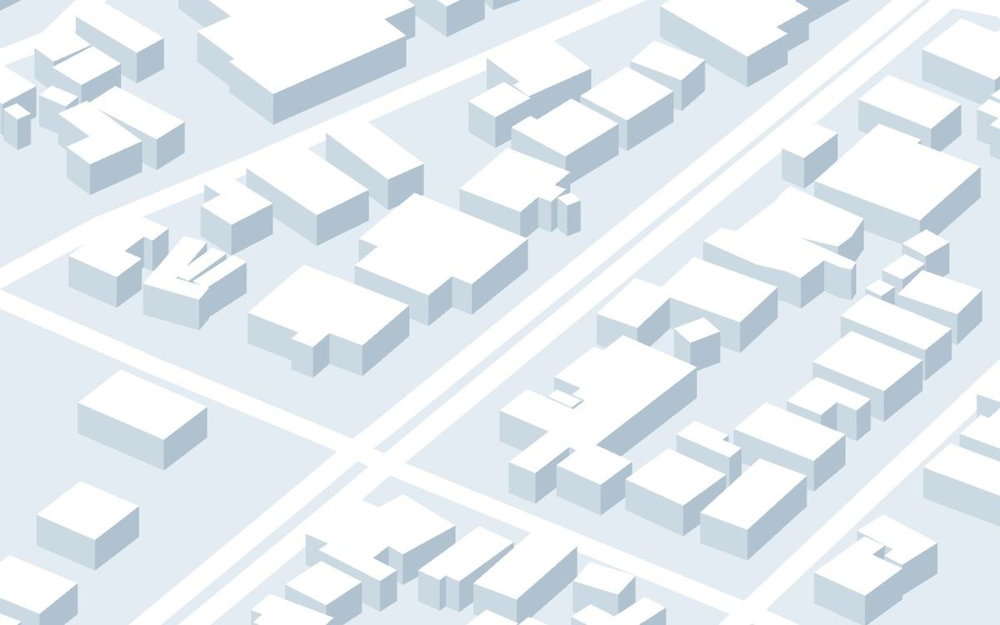
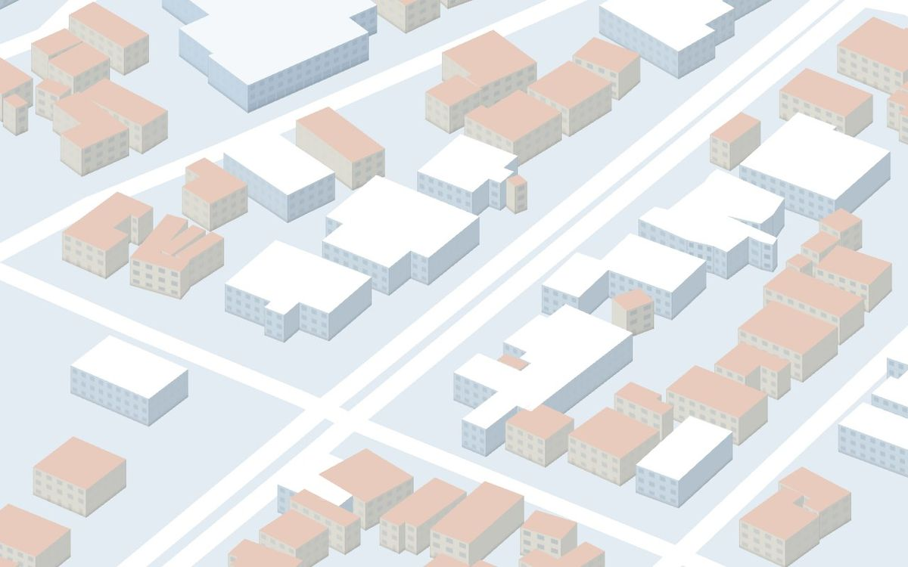
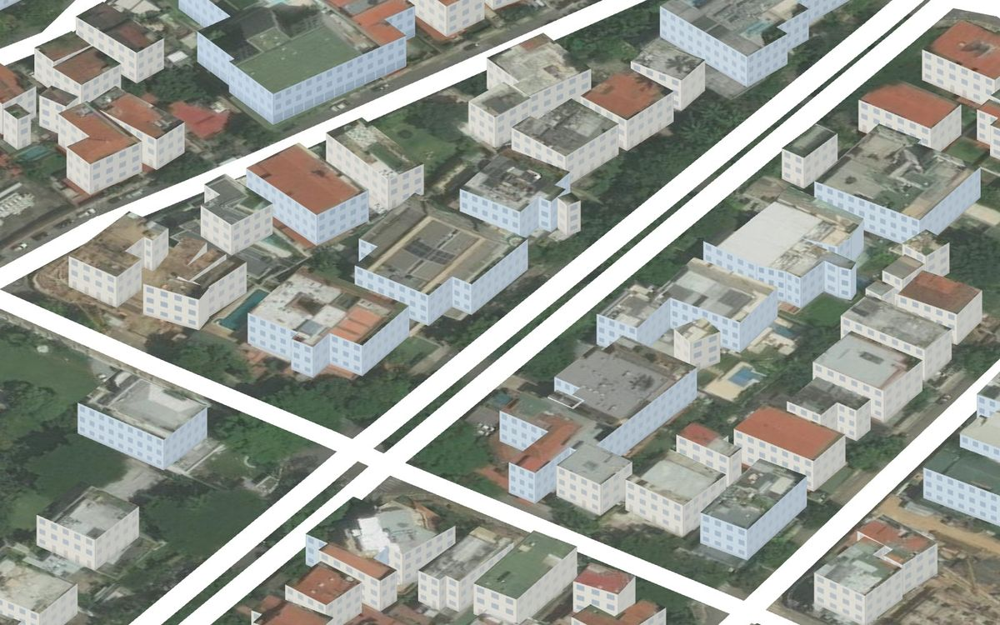
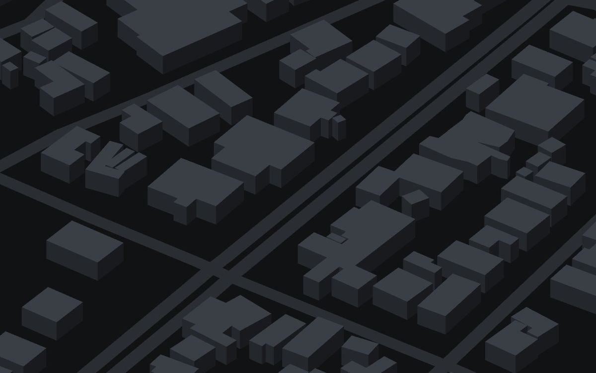
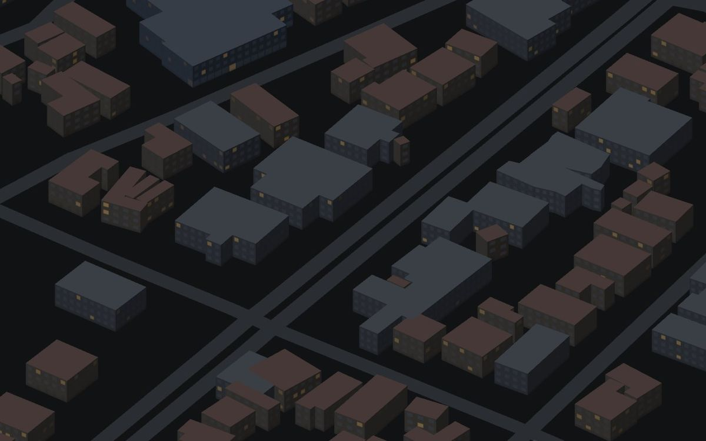

# Fachadas reales en la maqueta: resultados del experimento

Fecha: 25 oct 2026 · Zona: San Juan Bosco (teselas reales de `public/maqueta/`, 203 edificios) · Página aparte en
`experiments/fachadas/`: no toca `src/` ni las teselas.

```bash
npm run fachadas
```

La primera vez instala las dependencias del experimento (unos 40 s). Después abre <http://localhost:5190>.
Las pestañas cambian de enfoque y los botones de abajo cambian la cámara (isométrica como la pantalla
Maqueta, pájaro, calle) y el tema (oscuro/claro). **Capturar** guarda la vista en `capturas/`. Las claves
opcionales van en `experiments/fachadas/.env.local` (ver `.env.example`; ese archivo no se sube).

## Recomendación

1. **Ya: fachadas procedurales en la pantalla Maqueta.** Funcionan en toda zona con teselas, no bajan
   nada y cuestan un 7 % más por cuadro que los bloques de hoy. Se ven como maqueta con pisos y ventanas,
   no como la calle real.
   - Costo: 1–2 días.
   - **Lo que más mejora el realismo no es la textura sino la altura.** Hoy los 184 edificios de Microsoft
     están en 9 m por defecto. Hay alturas abiertas para Caracas: Google Open Buildings 2.5D Temporal
     (CC BY 4.0, ~4 m, 2016–2023) y 3D-GloBFP (CC BY 4.0). El uso (casa, residencial, comercial) puede
     salir de GHS-BUILT-C o del tag `building` de OSM.
   - Costo de traer alturas y uso: 2–3 días en `scripts/maqueta/build.ts`.
2. **Después: techos con imagen satelital de OpenAerialMap, horneada en las teselas.** Desde arriba,
   que es la vista del selector, es lo que más se parece a la realidad (captura abajo).
   - Imágenes Vantor de 2026, 0,33–0,42 m, licencia CC BY-NC 4.0: se pueden hornear mientras la app no
     sea comercial, citando "© Vantor, CC BY-NC 4.0, vía OpenAerialMap".
   - Vienen corridas 4,5–5,3 m respecto de nuestras huellas; el experimento mide ese corrimiento solo
     y lo corrige.
   - Costo: 2–3 días. Un atlas de techos por zona pesa unos 0,2–0,3 MB.
   - **Hace falta la decisión del equipo sobre la licencia no comercial.**
3. **Fachadas con fotos: solo con video propio, calle por calle.** Ninguna fuente pública de fotos de
   calle se puede usar en esta app (ver Licencias).
   - El horneado de este experimento lleva las fotos del video a paredes simples: 24 kB para 30 m de
     fachada, limpio y nítido, contra 29 MB y huecos de la malla de OpenMVS.
   - Para usarlo sobre la maqueta hace falta grabar con GPS (el grabador de la app) y ubicar el video
     (paso 6 de `pipeline3d/README.md`).
   - Costo: ~1 semana con la captura.
   - Riesgo propio de Caracas: desde la calle se ve el muro perimetral y la reja, no la fachada del
     edificio que dibuja la huella.
4. **Descartado:**
   - Google Photorealistic 3D Tiles: según la tabla de cobertura de Google, Venezuela solo tiene teselas
     2D, y los términos prohíben guardarlas, hornearlas o mostrarlas junto a un mapa que no sea de Google.
   - Street View, Mapillary (sus términos prohíben la navegación en tiempo real), Esri, Mapbox y Azure
     Maps (no permiten hornear y excluyen apps de navegación).
   - La malla de OpenMVS tal cual: 29 MB y 89 MB de memoria de textura no van en un teléfono. Comprimida
     queda en ~1 MB por cuadra, pero sirve para Simulación y como oclusor (`SPEC-3D-STREETS.md`), no para
     el selector.

## Tabla comparativa

Escritorio, ventana de 1280×800 a 1,25× (1600×1000 px), vista isométrica de toda la zona salvo donde se
indica. "ms por cuadro" es el promedio de 200 cuadros forzados esperando a la GPU (no hay FPS en vivo:
la pestaña estaba oculta). En un teléfono hay que esperar 5–10 veces más. No se probó en un teléfono real.

| Enfoque | Qué tan real | Calce con nuestras huellas | Datos extra / carga | ms por cuadro | Licencia | Para llevarlo a la app |
|---|---|---|---|---|---|---|
| **Hoy:** bloques planos | Bloques de tres tonos | Exacto (son las huellas) | 0 (las 4 teselas ya pesan 336 kB) | 1,38 | Propia (OSM ODbL, Microsoft ODbL) | — |
| **Procedural** | Pisos, ventanas, planta baja, techos de teja; color por uso estimado | Exacto | **0 B** | **1,48** (+7 %), 3 llamadas | Propia | Cambiar el material de `ui/maqueta.ts` por el shader; 1–2 días |
| **Techos OpenAerialMap** + paredes procedurales | **Muy real desde arriba**; borroso al nivel de la calle | Corrido 4,5–5,3 m; corregido con un desplazamiento por imagen | Mosaico z19 de la zona: 0,8–0,9 MB (2048², 22 MB de GPU). Atlas solo de techos: ~0,2–0,3 MB | 2,45 | **CC BY-NC 4.0**: hornear sí, uso no comercial, atribución | Script que baja el COG, recorta los techos y escribe un atlas por zona; 2–3 días |
| Techos Esri World Imagery (solo comparación) | Más nítido | Corrido 1,8 m | 1,1 MB | 2,45 | No se puede hornear; sin cuenta de ArcGIS no se puede usar; excluye apps de navegación | Descartado |
| **Video propio: malla OpenMVS** | Real, con huecos, manchas naranjas y carros pegados | Sin GPS no se puede ubicar; con GPS, ±3 m según el spec | **29,2 MB** (glb 12,1 + png 17,1), textura 4096² = 89 MB de GPU. Comprimida: ~0,4 MB de geometría + 0,63 MB de textura | 3,71 (428 k triángulos, vista pájaro) | Propia | Simulación y oclusor; no para el selector |
| **Video propio: paredes + fotos horneadas** | **Real y limpio donde hay foto** (71–90 % de la pared) | Igual que el GPS del video; la pared sale de la malla | **14–47 kB** de atlas JPEG por 30–55 m de fachada; 10–24 triángulos | **0,39** (vista pájaro) | Propia | Horneado offline por calle, con procedural donde falta foto; ~1 semana |
| Mapillary | No probado (sin token) | La pose del API (GPS del celular, ±5–10 m) | Miniaturas de 1024 px por foto | Igual que la fila anterior | CC BY-SA 4.0, y **el §5 de sus términos prohíbe la navegación en tiempo real** | Descartado salvo permiso de Meta |
| Google Photorealistic 3D Tiles | No probado (sin clave); el cargador sí se probó con un tileset público | `ReorientationPlugin` + ajuste del suelo con rayos | Por sesión; prohibido guardar en caché. 1.000 gratis al mes, después USD 6 por 1.000 | — | Prohíbe guardar en caché, hornear y mezclar con mapas que no sean de Google | Descartado (además, probablemente no hay 3D en Caracas) |

## Capturas

Misma cámara isométrica (la de la pantalla Maqueta, un poco más cerca), tramo de prueba de San Juan Bosco.

| Hoy | Procedural | Techos OpenAerialMap |
|---|---|---|
|  |  |  |
|  |  | |

- Vista pájaro: [procedural](capturas/procedural-pajaro-light.jpg) · [techos OpenAerialMap](capturas/aerea-pajaro-light.jpg)
  (techos y suelo: © Vantor, CC BY-NC 4.0, vía OpenAerialMap).
- Calle, procedural (edificio elegido en azul): [procedural-calle-dark](capturas/procedural-calle-dark.jpg).
- Corrimiento de la imagen satelital: [sin corregir](capturas/aerea-oam-sin-corregir.jpg) ·
  [corregida 5,3 m](capturas/aerea-oam-corregida.jpg).
- Video propio, vista pájaro: [malla OpenMVS](capturas/fotos-pajaro-malla.jpg) ·
  [paredes + fotos horneadas](capturas/fotos-pajaro-paredes.jpg).
- Video propio, desde la cámara de una foto: [malla](capturas/fotos-calle-malla.jpg) ·
  [paredes](capturas/fotos-calle-paredes.jpg). El gris es pared sin foto.

## Cada enfoque

### Procedural (`src/edificios.ts`)

- **Geometría.** Una sola malla para los 203 edificios (paredes y techos), una llamada de dibujo.
  Cada vértice lleva:
  - `aFac`: posición en la pared en metros (u a lo largo, v en altura, largo de la pared, altura del edificio);
  - `aBld`: índice del edificio, uso y semilla.
- **Shader.**
  - Pisos de ~3 m (la altura entre la cantidad de pisos).
  - Vanos de 2,6–3,6 m según el uso, centrados en cada pared.
  - Planta baja distinta: vidriera en comercios, puerta en casas.
  - Losas, esquinas y base más oscuras.
  - Ventanas encendidas al azar en el tema oscuro.
  - El detalle se apaga solo cuando una ventana queda por debajo de ~2 px, así que no hay moiré al alejarse.
- **Paletas.** Con detalle 0 y color por uso 0 da exactamente los tres tonos de la pantalla Maqueta.
  El tono de cada cara depende de la cámara, igual que `paint()` hoy.
- **Datos que faltan.** Las teselas no traen uso. Se estima por huella y altura: 153 casas,
  48 edificios, 2 comerciales y ninguna torre. Ninguna torre porque todo mide 9 m.

### Techos con imagen satelital (`src/aerea.ts`)

- Mosaico de teselas z19 en un canvas. Los techos lo muestrean por posición: sin UVs, el shader convierte
  x, z a coordenadas de la imagen.
- **Corrimiento medido.** El experimento desliza todos los contornos sobre el mapa de bordes (Sobel) de
  la imagen, ±8 m en pasos de 0,25 m:

  | Imagen | Corrimiento |
  |---|---|
  | OAM LG04, 9 feb 2026 | 5,3 m al sur |
  | OAM WV03, 27 jun 2026 | 4,5 m (1,5 este, 4,25 sur) |
  | Esri | 1,8 m al sur |

  Probablemente porque las huellas de Microsoft salieron de imágenes ortorrectificadas como las de
  Esri, mientras que las de Vantor en OAM son escenas sueltas con menos corrección. Con un desplazamiento por imagen calza bien
  (ver las capturas sin corregir y corregida). Los edificios altos se inclinan en imágenes oblicuas, pero
  esta zona casi no tiene.
- **Tamaño.** Los techos de la zona suman 57.665 m². A 0,33 m/px son ~530 k píxeles: un atlas de
  1024² en WebP, unos 0,2–0,3 MB. El mosaico entero de la zona (con suelo y árboles) pesa 0,8–0,9 MB.
- **CORS.** `tiles.openaerialmap.org` redirige al TiTiler de HOT sin cabecera CORS, así que el
  experimento pide directo a `titiler.hotosm.org`. En la app no se pediría en vivo: el script bajaría el
  COG una vez.
- Hay 9 imágenes de 2026 sobre la zona, todas de Vantor y CC BY-NC, subidas por HOT tras el sismo de
  junio de 2026. Conviene una de antes del sismo (la de febrero o la de marzo) o la de 0,33 m.

### Video propio (`src/fotos.ts`, `src/proyeccion.ts`)

- **Malla de OpenMVS tal cual.**
  - 29,2 MB y 428 k triángulos. Cargar y parsear: 3,7–6,9 s en escritorio desde disco local; en 4G
    serían más de 20 s de descarga.
  - La textura de 4096² ocupa 89 MB en la GPU.
  - Comprimida con gltf-transform (`simplify --ratio 0.25`, Draco) y la textura a 2048 en WebP:
    ~47 k triángulos y ~1 MB en total para unos 76 m de calle.
- **Paredes simples con las fotos horneadas.** Lo que haría la app con nuestras huellas.
  - **Dónde está la pared.** Rayos horizontales desde cada cámara hasta la primera celda de una
    rejilla de 0,3 m donde la malla tiene puntos abajo (0,4–1,4 m), en el medio (1,8–2,4 m) y arriba
    (2,5–3,4 m). Una pared es continua: un carro estacionado con un árbol encima deja un hueco entre el
    techo del carro y las hojas.
  - Con un solo rango de altura salían como pared las copas de los árboles sobre la acera y los carros.
    Sigue quedando una pared falsa de 5 m del lado este.
  - **Horneado.** Por cada pared se eligen las 4 mejores fotos (de frente, cerca, dentro del cuadro) y
    se proyectan desde su cámara. Se mezclan con peso por ángulo, cerca del borde del cuadro se funden, y
    se dibujan en un atlas en el espacio de UV.
  - Resultado: 5 paredes, ~29 m de fachada oeste, 71 % con foto, atlas de 2048×256 en 24 kB, horneado
    en ~2 s en el navegador con 20 de las 98 fotos.
  - Es un ~1/1000 del peso de la malla y se ve más nítido, porque cada píxel sale de la mejor foto en
    lugar del mosaico de OpenMVS.
- **Límites.**
  - El video mira siempre a la acera de enfrente, en diagonal. La fachada este casi no está en la malla.
  - Hay carros pegados en la planta baja de las fotos (hacen falta las máscaras del paso 4 del pipeline).
  - Sin GPS no se pudo poner sobre la maqueta. Para la app: grabar con el grabador, `georef.py`, y
    hornear sobre las paredes de las huellas en vez de las sacadas de la malla.
  - En Caracas, muchas huellas quedan detrás de un muro o una reja con árboles, y lo que la foto ve es
    eso. Proyectado sobre la huella, el muro queda "pintado" en la fachada, con un error de paralaje de
    unos metros.
  - Solución posible: una pared perimetral sacada de la malla o dibujada a mano en los overrides.

### Mapillary (`src/mapillary.ts`)

- **Código listo pero no probado contra el servicio** (necesita token).
- Pide las fotos de la caja con el API v4. Toma la pose de `computed_rotation` (OpenSfM) o, si no viene,
  del rumbo. Dibuja conos en la maqueta y, al tocar un edificio, hornea sus paredes con el mismo código
  que el video propio. Soporta fotos de 360°.
- **Cobertura desconocida:** todas las rutas del API piden token, la web no cargó en el navegador del
  experimento y OSM no tiene ningún `mapillary=*` en la zona. KartaView y Panoramax tienen 0 fotos en
  5 km a la redonda.
- **Licencia.** Las fotos son CC BY-SA 4.0: un atlas hecho con ellas tendría que publicarse CC BY-SA y
  no mezclarse con imágenes NC. **Bloqueo:** el §5 de los términos de Mapillary prohíbe usarlo
  "in connection with real-time navigation or route guidance". Vía AR es eso.

### Google Photorealistic 3D Tiles (`src/google.ts`)

- **Código listo, probado sin clave solo con un tileset público** (`?tileset=<url>`): bajada, conteo de
  bytes, render y ajuste del suelo.
- Con `VITE_GOOGLE_MAPS_KEY`:
  - usa `GoogleCloudAuthPlugin`;
  - restringe la carga a una esfera alrededor de la zona (`LoadRegionPlugin`);
  - recorta con planos a la caja;
  - gira el marco de la librería (x oeste, z norte) al nuestro (x este, z sur);
  - sube o baja la malla para que las calles coincidan con el relieve de la maqueta;
  - dibuja nuestras huellas encima, en rosa y sobre el relieve real, para medir el calce;
  - muestra las atribuciones.
- **Por qué no vale la pena:**
  - La tabla oficial de cobertura (oct. 2026) marca para Venezuela solo "Map Tiles 2D", no 3D. Con una
    clave se confirma en 5 minutos.
  - Aunque la hubiera, los términos (§3.2.3) prohíben guardarla en caché, sacar datos de ella (alturas,
    texturas) y mostrarla junto a un mapa que no sea de Google. La maqueta y nuestro mapa lo son.
  - Exige cuenta con facturación: 1.000 eventos gratis al mes, después USD 6 por 1.000.

## Licencias (resumen)

Informe completo, con fuentes y fechas, en [LICENCIAS.md](LICENCIAS.md). Lo esencial:

| Fuente | ¿Se puede hornear en nuestras teselas? | Condición |
|---|---|---|
| OpenAerialMap (Vantor 2026) | **Sí** | CC BY-NC 4.0: no comercial y atribución |
| Planet Crisis Response (Caracas, jun 2026) | Sí | CC BY-NC 4.0; 0,65–0,87 m, con nubes |
| Open Buildings 2.5D Temporal, 3D-GloBFP | **Sí** (alturas) | CC BY 4.0 |
| GHS-BUILT-C (JRC) | Sí (uso del suelo) | Citar la fuente |
| Overture | Sí | Trae 244 huellas de Google Open Buildings en la zona que no tenemos, sin alturas |
| Mapillary | Sí, como CC BY-SA | Sus términos prohíben la navegación en tiempo real |
| Google 3D, 2D y Street View | No | Prohíbe caché y contenido derivado; sin 3D en Venezuela |
| Esri, Mapbox, Azure Maps | No | Solo en vivo; Esri y Azure excluyen apps de navegación |

## Qué haría falta para llevarlo a la app

- **Pantalla Maqueta (`src/ui/maqueta.ts`):**
  - **Geometría.** `buildingMesh` se reemplaza por un constructor que agrega `aFac` y `aBld`, como
    `geometriaEdificios`. Mejor una sola malla por zona que una por edificio.
  - **Selección.** Se toca igual (rayo contra la malla; el índice del edificio está en `aBld`). El
    resaltado pasa a un uniforme (`uSel`) en vez de repintar colores por vértice, y `paint()` desaparece.
  - **Material.** `materialFachadas` con la paleta del tema. Los techos satelitales serían una textura
    más por zona, más `uAerialRect`.
- **Teselas (`scripts/maqueta/build.ts`):**
  - campos opcionales `use` y `heightSource` por edificio, con alturas de Open Buildings 2.5D o
    3D-GloBFP cuando OSM no tenga;
  - un `roofs.webp` por zona con el `rect` y el corrimiento ya corregido;
  - las fachadas con fotos: un `facades.jpg` por calle grabada, con UVs por pared en la tesela.
  - Las teselas viejas siguen cargando, porque todo es opcional.
- **Contorno del destino en la AR (`src/render/ar.ts`):** las texturas no sirven ahí, porque la cámara
  ya muestra la fachada real. Lo que sí mejora la AR:
  - **la altura real** (el aura y el contorno hoy suben 9 m en todos los edificios);
  - la malla de fotogrametría o las paredes horneadas como oclusor que solo escribe profundidad
    (fase 4 de `MAQUETA.md`), para que la flecha quede detrás de las esquinas.
  - Google no se puede usar ni para eso: los términos prohíben guardar en caché y no hay 3D en Caracas.

## Qué necesita al equipo

- **Decidir si la app seguirá siendo no comercial.** La licencia CC BY-NC de OpenAerialMap depende de
  eso. Si no, para techos solo queda pagar imagen comercial con derecho a hornear, o no usar imagen.
- **Dónde se grabó el video de `PRUEBA RENDER/`**: no tiene GPS ni pistas en los archivos. Para la
  prueba de verdad de fachadas con fotos hace falta un video nuevo de un tramo de San Juan Bosco: 4K,
  las dos aceras, con el grabador de la app encendido.
- **Opcional:** una clave de Google Maps Platform (con facturación) solo para confirmar que no hay 3D en
  Caracas. No hace falta para decidir.
- **Mapillary:** no pedir token mientras no haya permiso para navegación.

## Cómo está hecho

| Archivo | Qué hace |
|---|---|
| `vite.config.ts` | Vite aparte. Sirve `public/` de la app (las teselas), `PRUEBA RENDER/` en `/prueba/` y `.cache/` en `/cache/`; `POST /__captura` guarda capturas |
| `src/zona.ts` | Carga la zona con `src/core/maqueta.ts` y `src/core/geo.ts` de la app: mismas coordenadas que la pantalla Maqueta |
| `src/edificios.ts` | Malla única, shader procedural, paletas, suelo y calles, contornos |
| `src/aerea.ts` | Mosaico satelital y medición del corrimiento |
| `src/proyeccion.ts` | Proyección y horneado de fotos en un atlas (perspectiva y 360°) |
| `src/fotos.ts` | Malla OpenMVS, paredes desde la malla, horneado con las fotos del video |
| `src/mapillary.ts` | API v4, poses, conos, horneado por edificio |
| `src/google.ts` | 3D Tiles: autenticación, recorte, marco, ajuste del suelo, conteo de bytes |
| `src/main.ts` | Página, cámaras, mediciones y `window.__fachadas` para capturar y medir desde la consola |

- **Hay que mirar con el panel visible.** Con la pestaña del navegador oculta, `requestAnimationFrame`
  se pausa: no anima y 3d-tiles-renderer no baja teselas (sus colas usan rAF).
- **Mediciones.** `__fachadas.medir()` mide ms por cuadro sin rAF. Los tiempos de carga de esta tabla
  son de corridas sin throttling.
- `.cache/` (ignorado por git) guarda las pruebas de compresión de la malla.
